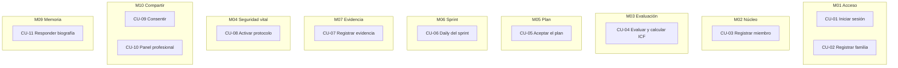
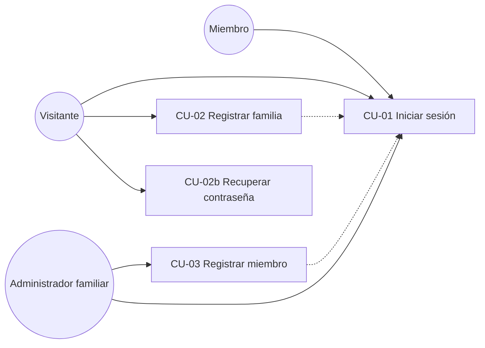
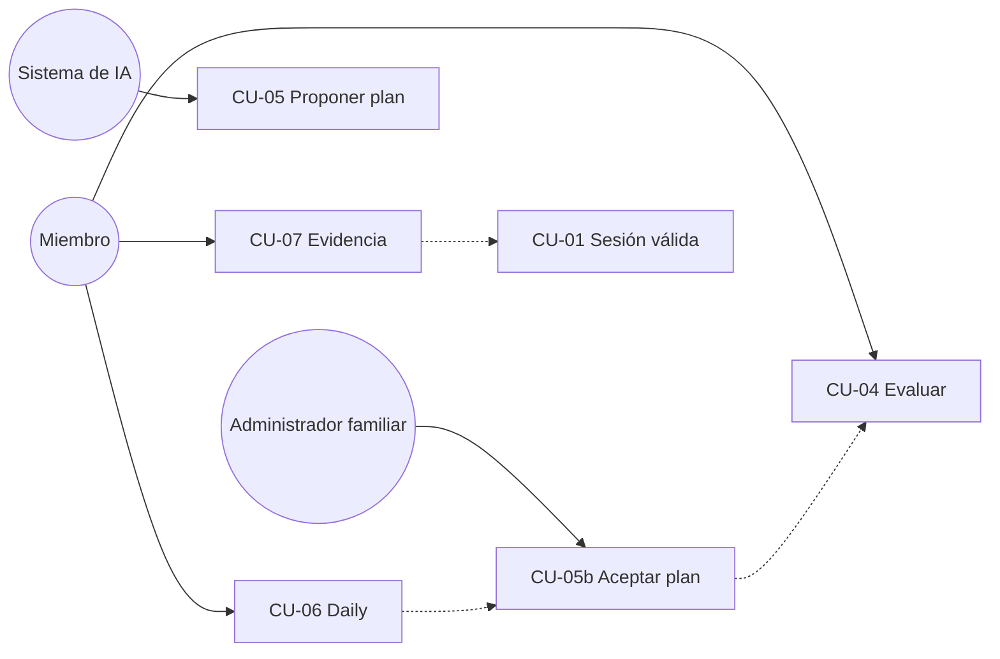
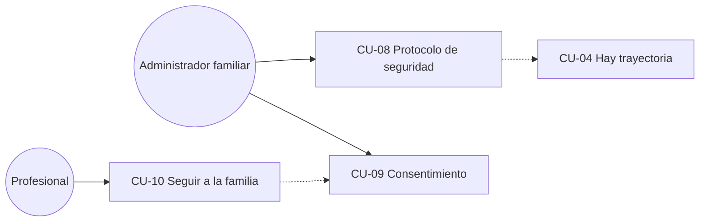
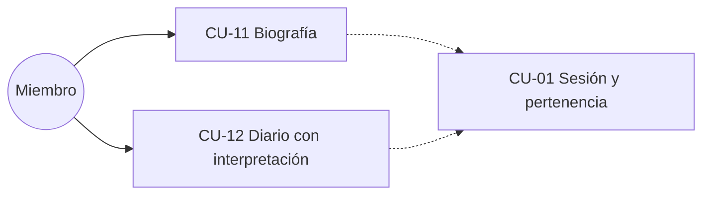

# PT-ECU-02. Especificación de Casos de Uso del Sistema Integrity Family

## Nombre del Proyecto

Integrity Family

## Número de versión

1.0 — 16/11/2026. Código oficial 2026: PT-ECU-02.

Este documento define los casos de uso observados en el código: la interacción entre los actores de la sección 3 del PT-ERS-02 y los módulos ya construidos.

**HISTORIAL DE REVISIÓN**

| Versión | Fecha Elaboración | Responsable Elaboración | Fecha Aprobación | Responsable Aprobación |
| --- | --- | --- | --- | --- |
| 1.0 | 16/11/2026 | William Lopez | [Pendiente: fecha de aprobación del instructor] | [Pendiente: nombre del instructor] |

**CAMBIOS RESPECTO A LA VERSIÓN ANTERIOR**

| **VERSIÓN** | **MODIFICACIÓN RESPECTO VERSIÓN ANTERIOR** |
| --- | --- |
| 1.0 | Creación del documento. Los diagramas están en Mermaid porque el repositorio no contiene imágenes UML exportadas. |

## Tabla de Contenido.

1. Introducción
2. Descripción general de actores
3. Diagrama de casos de uso
4. Especificación de casos de uso

## 1. Introducción

Los casos de uso describen lo que una persona o un sistema externo logra con Integrity Family. Se limitan a flujos que tienen ruta, endpoint o servicio en el repositorio. Los identificadores CU coinciden con los requisitos RF del PT-ERS-02 para poder trazarlos.

## 2. Descripción general de actores

| **ACTOR** | **DESCRIPCIÓN DETALLADA** |
| --- | --- |
| Visitante | Llega sin token. Solo usa textos legales, registro, login y recuperación. El guard de autenticación lo devuelve a `/auth/login`. |
| Administrador familiar | Titular de `ROLE_FAMILY_ADMIN`. Crea el núcleo, invita, acepta el plan, abre el sprint y otorga consentimientos. |
| Miembro de familia | Consta en `family_members` y, si tiene usuario, opera dentro de esa familia. Responde evaluación, daily, diario y evidencia. |
| Administrador de plataforma | `ROLE_ADMIN` o, en el frontend, el correo institucional fijado en `admin.guard.ts`. Entra a `/api/admin/**` y el validador no le niega una familia. |
| Profesional de apoyo | Terapeuta, orientador o trabajador social. Ve el panel y, en modo observación, un subconjunto del menú familiar. |
| Sistema de IA | Servicio interno. Redacta propuestas. No cierra evidencias ni abre el protocolo de seguridad. |
| Alexa | Cliente de las rutas públicas de OAuth y de la skill. |

## 3. Diagrama de Casos de Uso

Mermaid no tiene una primitiva UML de casos de uso. Los diagramas usan nodos de actor y de caso. La relación punteada indica un include: el caso no sigue si el incluido falla.

### 3.1. General

Paquetes de casos, alineados con M01–M11.

### 3.2. Específicos

#### 3.2.1 Subsistema Acceso y núcleo

#### 3.2.2 Subsistema Evaluación, plan y sprint

#### 3.2.3 Subsistema Riesgo, consentimiento y profesional

#### 3.2.4 Subsistema Memoria

## 4. Especificación de Casos de Uso

La plantilla guarda esta sección en una base de Notion sin columnas exportadas. Cada caso usa la misma tabla de campos: identificador, nombre, actor, requisitos, precondición, flujo básico, flujo alterno y postcondición. Se especifican los casos principales. El resto de requisitos del PT-ERS-02 se cubre por extensión de estos flujos y por la matriz del índice.

### CU-01 – Iniciar sesión

| Campo | Contenido |
| --- | --- |
| ID | CU-01 |
| Nombre | Iniciar sesión |
| Actor principal | Visitante con cuenta |
| Requisitos | RF02, RF03, RF08, RNF07, RNF08, RNF10 |
| Precondición | Existe un usuario habilitado. El cliente no tiene token válido. |
| Flujo básico | 1. Abre `/auth/login`. 2. Escribe correo y contraseña. 3. El frontend llama `POST /api/auth/login`. 4. `AuthService` valida el hash BCrypt. 5. Se emite JWT con correo, id, familia y roles. 6. Si es profesional, navega a `/professional`; si no, al hogar familiar. |
| Flujo alterno | Credenciales inválidas: mensaje «Credenciales incorrectas.» Cuenta bloqueada: «Tu cuenta ha sido bloqueada temporalmente por seguridad.» Servidor caído (HTTP 0, 502, 503, 504): mensaje de mantenimiento. |
| Postcondición | Hay token. `GET /api/auth/me` responde el usuario. |

### CU-02 – Registrar familia

| Campo | Contenido |
| --- | --- |
| ID | CU-02 |
| Nombre | Registrar una familia nueva |
| Actor principal | Visitante |
| Requisitos | RF01, RF04, RF09 |
| Precondición | El correo no existe. La persona acepta la política y los términos. |
| Flujo básico | 1. Abre `/auth/register` en modo «Crear familia». 2. Diligencia nombre, correo, contraseña, confirmación, nombre de familia, municipio y departamento. 3. Marca la aceptación. 4. `POST /api/auth/register-family` crea el usuario con `ROLE_FAMILY_ADMIN` y el núcleo. 5. Queda en condiciones de iniciar sesión. |
| Flujo alterno | Sin aceptación: «Debes aceptar la Política de Privacidad y los Términos de Uso para continuar.» Contraseñas distintas: «Las contraseñas no coinciden.» Correo repetido: «El correo ya está registrado en el sistema.» Modo voucher: CU-02 no aplica; se usa RF05. |
| Postcondición | Hay fila en `users`, `user_roles` y `families`. El hito inicial de la familia es `W1`. |

### CU-03 – Registrar miembro

| Campo | Contenido |
| --- | --- |
| ID | CU-03 |
| Nombre | Registrar miembro del núcleo |
| Actor principal | Administrador familiar |
| Requisitos | RF10, RF11, RF12 |
| Precondición | CU-01 superado y la familia activa es la suya. |
| Flujo básico | 1. Abre `/members`. 2. Indica el nombre. 3. Opcionalmente correo, teléfono de 10 dígitos, rol, edad, fecha de nacimiento y documento. 4. El API crea `family_members` ligado a `family_id`. |
| Flujo alterno | Nombre vacío: «El nombre es obligatorio.» Sin familia activa: «Error interno: No se ha seleccionado ninguna familia activa.» Teléfono mal formado: «Ingresa un número de 10 dígitos.» Otro núcleo: el validador responde «Acceso denegado» o «No tienes permisos sobre este núcleo familiar». |
| Postcondición | El miembro existe y puede recibir tareas, evaluaciones y autoría de diario. |

### CU-04 – Evaluar y calcular el ICF

| Campo | Contenido |
| --- | --- |
| ID | CU-04 |
| Nombre | Iniciar, responder y cerrar una evaluación |
| Actor principal | Miembro o administrador familiar |
| Requisitos | RF17, RF18, RF19, RF20, RF24 |
| Precondición | Sesión válida y pertenencia a la familia. |
| Flujo básico | 1. Abre `/evaluations/start` y elige pilar. 2. Responde en `/evaluations/:id/form` con los textos de la Ruta de Conciencia o con el escenario de fase congelada. 3. Finaliza. 4. El servicio calcula el ICF y las dimensiones y deja la evaluación cerrada. 5. Puede ver resultado, historial y evolución. |
| Flujo alterno | Sin pilar: «Selecciona un pilar para comenzar.» Fallo al cerrar: «Error al finalizar el diagnóstico. Intenta de nuevo.» Tiempo de espera largo: «El servidor tardó más de lo habitual». |
| Postcondición | Hay `evaluations` finalizada, respuestas y, si el cálculo corre, snapshot de riesgo. El ICF no etiqueta a la familia (`docs/vision.md`). |

### CU-05 – Aceptar el plan propuesto

| Campo | Contenido |
| --- | --- |
| ID | CU-05 |
| Nombre | Recibir y aceptar el plan de mejora |
| Actor principal | Administrador familiar. El sistema de IA propone. |
| Requisitos | RF30, RF31, RF32, RF33 |
| Precondición | Existe una evaluación o el contexto mínimo que el generador exige. |
| Flujo básico | 1. El generador escribe `plans` y `plan_tasks`. 2. La familia lee `/plans`. 3. Registra la aceptación (`acceptedAt`, `acceptedBy`, declaración de intención, `V111`). 4. Las tareas quedan disponibles para responsables. Completar una tarea no crea evidencia. |
| Flujo alterno | La familia no acepta: el plan permanece sin aceptación. Un ajuste adaptativo queda pendiente hasta aprobar, rechazar o aplicar (RF34). |
| Postcondición | Hay como máximo un plan activo aceptado para la familia. |

### CU-06 – Registrar el daily del sprint

| Campo | Contenido |
| --- | --- |
| ID | CU-06 |
| Nombre | Crear sprint y registrar el daily |
| Actor principal | Miembro. El administrador familiar abre el sprint. |
| Requisitos | RF36, RF37, RF38, RF39 |
| Precondición | Plan aceptado o decisión explícita de abrir sprint. Duración 7 o 15 días. |
| Flujo básico | 1. Crea el sprint en `/sprint` o en la bitácora. 2. Define misiones. 3. Cada día registra el daily, incluido `attempt_status` cuando responde. 4. Al cierre, la retrospectiva guarda lo que salió bien y la tensión. |
| Flujo alterno | Segundo daily del mismo día: «Ya registraste tu Daily el día de hoy.» Error de guardado: «Error al guardar el daily.» Misión pospuesta o cambiada por acuerdo: sale del denominador de cumplimiento. |
| Postcondición | Hay `family_sprints`, `sprint_missions`, `sprint_dailies` y, al cerrar, `sprint_retrospectives`. |

### CU-07 – Registrar evidencia

| Campo | Contenido |
| --- | --- |
| ID | CU-07 |
| Nombre | Registrar evidencia de una misión |
| Actor principal | Miembro |
| Requisitos | RF42, RF43, RF45 |
| Precondición | Sesión válida. La tarea es opcional desde `V65`. |
| Flujo básico | 1. Abre la cápsula o el checklist. 2. Envía texto, archivo, emoción o ubicación. 3. Queda `task_evidences`. 4. Quien revisa puede validar o rechazar. El comentario de IA no es una calificación. |
| Flujo alterno | Sin familia o sin permiso: el validador niega el acceso. Fallo de mensajería al analizar la evidencia: la evidencia ya guardada no se revierte. |
| Postcondición | La evidencia existe aunque la tarea siga abierta, y al revés. |

### CU-08 – Activar el protocolo de seguridad

| Campo | Contenido |
| --- | --- |
| ID | CU-08 |
| Nombre | Activar y cerrar el protocolo de seguridad |
| Actor principal | Persona con acceso a la familia que confirma la acción |
| Requisitos | RF25, RF26, RF27, RF28 |
| Precondición | La trayectoria asignada exige protocolo o la persona decide abrirlo. Hay un miembro responsable. |
| Flujo básico | 1. Consulta `/trajectory`. 2. Confirma responsable, acción inicial y fecha de seguimiento. 3. `POST .../safety-protocol` crea `safety_protocol_activations`. 4. Más adelante cierra con notas. |
| Flujo alterno | Nadie confirma: no hay fila. Un riesgo critical no abre solo el protocolo (corrección documentada en `V99`). El ritual de misión fallida es otro caso y otro módulo. |
| Postcondición | La activación tiene responsable real y fecha de seguimiento, o queda cerrada con notas. |

### CU-09 – Otorgar consentimiento

| Campo | Contenido |
| --- | --- |
| ID | CU-09 |
| Nombre | Otorgar o revocar un consentimiento |
| Actor principal | Administrador familiar |
| Requisitos | RF59, RF60, RF61 |
| Precondición | Sesión válida sobre esa familia. |
| Flujo básico | 1. Indica propósito, alcance y receptor. 2. `POST /api/families/{id}/consents` guarda `consents` y un `AuditEvent`. 3. La revocación marca estado y autor. 4. El registro canónico y el bundle FHIR solo incluyen lo que el ensamblador lee para esa familia. |
| Flujo alterno | Falta propósito, alcance o receptor: validación «El propósito es obligatorio» y mensajes equivalentes del DTO. Sin pertenencia: acceso denegado. |
| Postcondición | El consentimiento queda otorgado o revocado, con auditoría. El mapa clínico externo sigue vacío mientras `TerminologyService` no tenga códigos validados. |

### CU-10 – Acompañar desde el panel profesional

| Campo | Contenido |
| --- | --- |
| ID | CU-10 |
| Nombre | Consultar una familia asignada y dejar un borrador |
| Actor principal | Profesional de apoyo |
| Requisitos | RF57, RF58, RF03 |
| Precondición | El usuario tiene rol profesional y un vínculo de red o de ecosistema. |
| Flujo básico | 1. Inicia sesión y cae en `/professional`. 2. Elige una familia y entra en observación. 3. El menú muestra evolución, historial, ICaF, plan, salud, trayectorias y ecosistema. 4. Puede generar un borrador que congela el vistazo (`professional_follow_up_drafts`). |
| Flujo alterno | Un familiar sin rol profesional no ve el menú clínico. Un administrador de plataforma usa el bloque `/admin`, que es otro caso. |
| Postcondición | El borrador guarda la foto de los datos vistos. La nota no se publica como hecho clínico codificado. |

### CU-11 – Responder la biografía

| Campo | Contenido |
| --- | --- |
| ID | CU-11 |
| Nombre | Responder el diario biográfico guiado |
| Actor principal | Miembro |
| Requisitos | RF51 |
| Precondición | Catálogo sembrado por `BiographyQuestionDataInitializer`. Sesión de un miembro de la familia. |
| Flujo básico | 1. Abre `/biography`. 2. Elige capítulo y pregunta. 3. Escribe la respuesta, la fuente epistémica y la visibilidad. 4. El backend toma el autor del principal autenticado. |
| Flujo alterno | Respuesta vacía: «La respuesta no puede estar vacía». Borrar pide «¿Borrar esta respuesta? Esta acción no se puede deshacer.» |
| Postcondición | Una fila en `biography_answers` por miembro y pregunta. |

### CU-12 – Escribir el diario separando hecho e interpretación

| Campo | Contenido |
| --- | --- |
| ID | CU-12 |
| Nombre | Registrar un diario con interpretación aparte |
| Actor principal | Miembro |
| Requisitos | RF41 |
| Precondición | Sesión válida. |
| Flujo básico | 1. En Mi Espacio o en el diario de familia escribe el hecho. 2. Si quiere, agrega interpretación, explicación alternativa y señal corporal (`V115`). 3. La visibilidad por defecto es privada. |
| Flujo alterno | En Mi Espacio, sin título o contenido: «El título y el contenido son obligatorios.» Éxito: «Reflexión guardada en tu espacio privado.» |
| Postcondición | El hecho y la interpretación quedan en campos distintos. El ICF no cambia por este registro (comentario de `V115`). |
