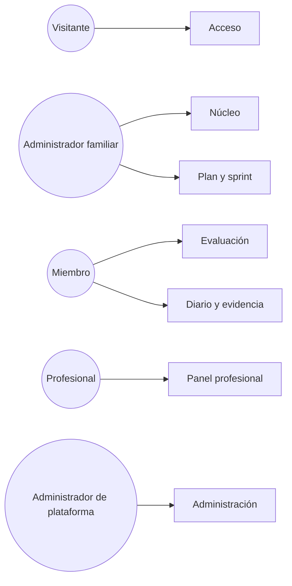

# Integrity Family

### Informe general del sistema

Este documento presenta las características, los roles, los casos de uso y las historias de usuario del sistema ya construido.

**NOMBRE PROYECTO**

Integrity Family

**Nombre Estudiante**

William Lopez

**Nombre Estudiante**

[Pendiente: nombres de los demás aprendices del equipo]

**CENTRO DE FORMACIÓN**

[Pendiente: centro de formación SENA]

**TITULACIÓN**

[Pendiente: programa y código de ficha. El único indicio institucional en el código es el correo `william_lopezb@soy.sena.edu.co` en `admin.guard.ts`.]

**CIUDAD**

[Pendiente: ciudad y regional. El registro de familia pide municipio y departamento y asume país `CO` por defecto; eso no fija la sede del equipo.]

**AÑO**

2026

## TABLA DE CONTENIDO

1. Introducción
2. Objetivo
3. Alcance
4. Situación actual
5. Situación esperada
6. Justificación
7. Características del sistema
8. Usuarios y roles
9. Diagrama de casos de uso
10. Historias de usuario

## 1. INTRODUCCIÓN

Integrity Family acompaña a un núcleo familiar durante un proceso de hasta 36 meses. Mide un Índice de Cohesión Familiar, propone un plan, sostiene sprints y guarda la memoria del núcleo. La aplicación es web: Angular 17 en el navegador y Spring Boot 3.4.3 en el servidor, con MySQL 8.4. Este informe resume el sistema que está en la rama `feature/v1.2-micro-simulations`. El detalle de requisitos está en el PT-ERS-02 y el de casos de uso en el PT-ECU-02.

## 2. OBJETIVO

Ofrecer a una familia un lugar donde reconocer su estado de convivencia, decidir un plan y sostener prácticas de cuidado, sin que la inteligencia artificial califique la evidencia ni active sola un protocolo ante un riesgo vital.

Ese objetivo sale de `docs/vision.md` (el ICF orienta y no juzga; ninguna IA es fuente única de verdad) y de ADR-019.

## 3. ALCANCE

Entra en este sistema:

- Registro, sesión y recuperación de contraseña.
- Núcleo familiar, miembros, guardián y perfil.
- Evaluación ICF, Ruta de Conciencia, micro-simulaciones `SCENARIO_V1_2` e ICaF.
- Riesgo, banco de trayectorias y protocolo de seguridad manual.
- Plan con aceptación, tareas, sprint de 7 o 15 días, daily, bitácora, diario y evidencias.
- Hogar Digital, ruta de hitos, vitalidad, biografía, linaje, legado y documental.
- Panel profesional, consentimiento, registro canónico y bundle FHIR de lectura.
- Tablero, reportes PDF y Excel, chat y herramientas de administración.

Queda fuera, porque el código no lo implementa o lo deja explícitamente pendiente:

- Pasarela de pagos.
- Codificación clínica SNOMED, LOINC o CIE-10 validada.
- Consumidor real del Ministerio de Salud o de una IPS.
- Borrado automático de la cuenta a los 30 días anunciados en la política.
- Aplicación móvil nativa. Hay una ruta `/portal` dentro de la misma SPA.
- [Pendiente: alcance geográfico y población del piloto.]

## 4. SITUACIÓN ACTUAL

El problema de fondo está escrito en `docs/vision.md`: compartir techo no equivale a construir una historia común, y el cuidado puede fallar. El repositorio ya contiene un sistema de desarrollo que modela esa situación con familias, evaluaciones, planes, sprints, trayectorias críticas y consentimiento. Las contradicciones entre `README.md`, `docs/architecture.md`, `pom.xml` y `package.json` (versión de Java y de Angular) forman parte del estado documental actual. El desarrollo de esta sección, con citas por archivo, está en la sección 3 del PT-PP-01.

## 5. SITUACIÓN ESPERADA

La familia se registra, se mira en el Hogar Digital, responde una evaluación, acepta o no el plan, sostiene el sprint, deja evidencia y memoria, y solo comparte datos con un tercero si otorga un consentimiento revocable. Un profesional asignado observa y redacta un borrador sin convertirse en fuente única de verdad. El desarrollo está en la sección 4 del PT-PP-01.

## 6. JUSTIFICACIÓN

La solución se sostiene en decisiones ya versionadas: aceptación del plan (`V111`), evidencia separada de la tarea (ADR-019), hipótesis fuera del estado operacional (`V106`), protocolo de seguridad manual (`V98`) e interoperabilidad desacoplada del dominio (`CLAUDE.md`, fases 0 a 5). La justificación extendida está en la sección 5 del PT-PP-01. [Pendiente: justificación de mercado y de costos.]

## 7. CARACTERÍSTICAS DEL SISTEMA

- Aplicación web responsive servida como estáticos, con reescritura a `index.html` (`if-frontend/vercel.json`).
- API REST en el puerto 8080, salud en `/actuator/health`.
- Autenticación JWT stateless y contraseñas BCrypt.
- MySQL 8.4 y 113 migraciones Flyway (V1–V115, sin V61 ni V88).
- 122 entidades JPA y 77 controladores REST.
- Mensajería RabbitMQ opcional.
- Proveedor de IA intercambiable; Claude es el descrito como principal.
- Exportación PDF (iText 8.0.2) y Excel (Apache POI 5.2.5).
- Bundle FHIR R4 con HAPI FHIR 8.10.0, de solo lectura.
- Idioma de interfaz: español.
- Zona horaria de la base local: `America/Bogota`.
- Umbral de cobertura de líneas en integración continua: 65 %.
- [Pendiente: versiones de navegador soportadas y tamaño mínimo de pantalla certificados por prueba.]

## 8. USUARIOS – ROLES

### 8.1 Visitante

Consulta la política y los términos, se registra o recupera la contraseña. No ve el menú del hogar.

### 8.2 Administrador familiar

Crea el núcleo y conduce el ciclo de evaluación, plan, sprint, evidencia y consentimiento. En base de datos su rol es `ROLE_FAMILY_ADMIN`.

### 8.3 Miembro de familia

Participa en evaluación, daily, diario, biografía y evidencias del núcleo al que pertenece. El rol de Spring `ROLE_FAMILY_MEMBER` está sembrado y no se asigna en el flujo Java revisado; la pertenencia la decide `family_members`.

### 8.4 Administrador de plataforma

Opera familias, estadísticas, reglas EEDSL, sandbox y monitor de voz. Su rol es `ROLE_ADMIN`. El frontend también admite un correo institucional fijo en el guard.

### 8.5 Profesional de apoyo

Terapeuta, orientador o trabajador social. Entra al panel profesional y, si observa una familia, ve el submenú clínico. No administra la plataforma salvo que además tenga `ROLE_ADMIN`.

### 8.6 Sistema de IA y Alexa

No son personas. La IA redacta. Alexa usa rutas públicas de OAuth y de skill. Un consumidor FHIR podría leer el bundle; hoy no hay uno conectado. [Pendiente: nombre de la institución consumidora.]

## 9. Diagrama de Casos de Uso

### 9.1 General

El diagrama de paquetes y el diagrama de actores están en la sección 3 del PT-ECU-02. Aquí se resume la relación de los roles con el ciclo principal.

### 9.2 Específicos

#### 9.2.1 Subsistema Acceso y núcleo

CU-01 Iniciar sesión, CU-02 Registrar familia, CU-03 Registrar miembro. Diagramas en el PT-ECU-02, sección 3.2.1.

#### 9.2.2 Subsistema Evaluación, plan y sprint

CU-04 Evaluar, CU-05 Aceptar el plan, CU-06 Daily, CU-07 Evidencia. Sección 3.2.2 del PT-ECU-02.

#### 9.2.3 Subsistema Riesgo, consentimiento y memoria

CU-08 Protocolo de seguridad, CU-09 Consentimiento, CU-10 Panel profesional, CU-11 Biografía, CU-12 Diario. Secciones 3.2.3 y 3.2.4 del PT-ECU-02.

## 10. HISTORIAS DE USUARIO

La plantilla usa una base de Notion. Las historias siguientes usan la misma estructura para todas: identificador, historia, requisito, prioridad y criterio comprobable en el código. La prioridad retoma el tipo del requisito (esencial = alta).

| ID | Historia | Requisito | Prioridad | Criterio de aceptación observable |
| --- | --- | --- | --- | --- |
| HU-01 | Como visitante, quiero registrarme con mi familia para empezar el acompañamiento. | RF04 | Alta | `POST /api/auth/register-family` crea usuario `ROLE_FAMILY_ADMIN` y familia en hito `W1`. Prueba de servicio de autenticación en el paquete `auth`. |
| HU-02 | Como persona registrada, quiero entrar con correo y contraseña para llegar a mi espacio. | RF02, RF03 | Alta | Login emite JWT. El profesional va a `/professional` y la familia al hogar. |
| HU-03 | Como administrador familiar, quiero agregar miembros para que cada quien responda por su parte. | RF11 | Alta | `family_members` exige nombre y se ata a `family_id`. `MemberServiceTest`. |
| HU-04 | Como miembro, quiero responder la evaluación con frases de conciencia para no ser etiquetado con una nota. | RF18, RF20 | Alta | La pantalla muestra el texto de `RUTA_CONCIENCIA_SCALE` y el cierre persiste el ICF. |
| HU-05 | Como familia, quiero ver el plan propuesto y aceptarlo antes de que organice nuestras tareas. | RF30, RF31 | Alta | `plans` guarda aceptación (`V111`). Completar la tarea no crea evidencia. |
| HU-06 | Como miembro, quiero registrar el daily del sprint, incluso cuando no hubo oportunidad. | RF38 | Alta | `attempt_status` admite los cuatro valores de `AttemptStatus` y NULL si no se responde (`V114`). |
| HU-07 | Como miembro, quiero dejar una evidencia distinta de marcar la tarea como hecha. | RF42, RF33 | Alta | `task_evidences.task_id` es nullable. `EvidenceAnalysisConsumerTest` fija que la IA comenta y no califica. |
| HU-08 | Como responsable, quiero activar el protocolo de seguridad solo cuando una persona lo confirma. | RF27 | Alta | `SafetyProtocolServiceTest` y `V98`: responsable, acción y fecha de seguimiento. |
| HU-09 | Como administrador familiar, quiero otorgar y revocar el permiso de compartir datos. | RF59 | Alta | `consents` más evento de auditoría. |
| HU-10 | Como profesional, quiero ver solo las familias asignadas y dejar un borrador de seguimiento. | RF57, RF58 | Alta | Panel `/professional` y `ProfessionalFollowUpDraftServiceTest`. |
| HU-11 | Como miembro, quiero contar un recuerdo de la biografía sin que el sistema invente el autor. | RF51 | Media | El autor sale del principal. Catálogo en `biography_questions`. |
| HU-12 | Como miembro, quiero separar lo que pasó de lo que interpreté. | RF41 | Media | Columnas de `V115` en `journal_entries`. El ICF no se recalcula por ese registro. |
| HU-13 | Como administrador de plataforma, quiero ver estadísticas sin entrar como si fuera un miembro. | RF67, RF10 | Alta | `/api/admin/**` exige `ROLE_ADMIN`. El validador deja pasar al administrador y niega a un extraño. `FamilySecurityEvaluatorTest`. |
| HU-14 | Como familia, quiero abrir el Hogar Digital al entrar, no un tablero genérico. | RF46 | Alta | La ruta autenticada por defecto es `family-home` (`app.routes.ts`, ADR-002). |
| HU-15 | Como familia, quiero registrar sueño, ejercicio y fatiga sin obligarme a completar todo el día. | RF50 | Media | Todos los campos numéricos de `daily_vitality_logs` aceptan NULL (`V110`). |
