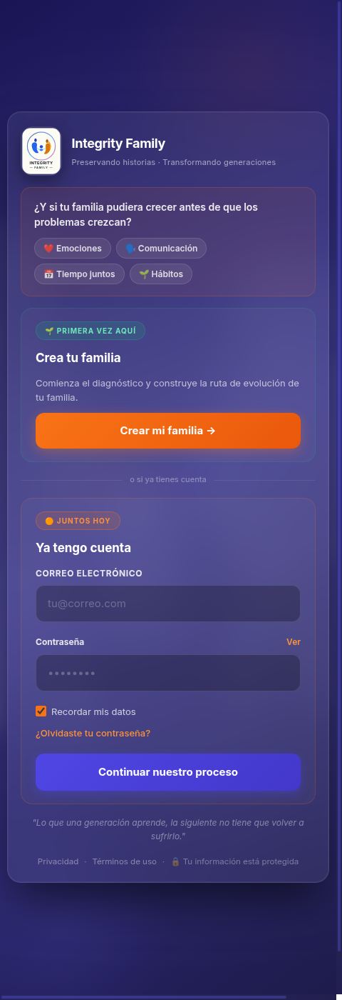
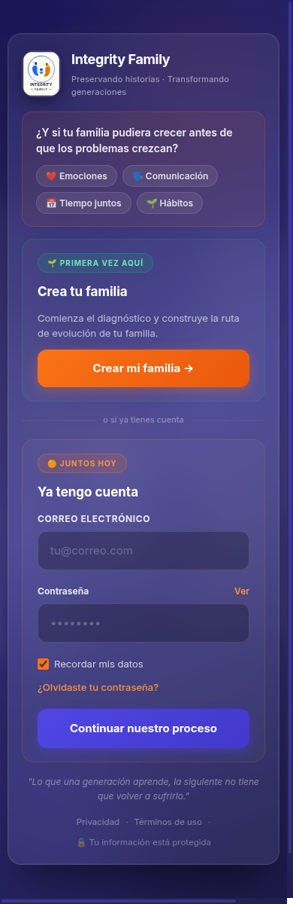
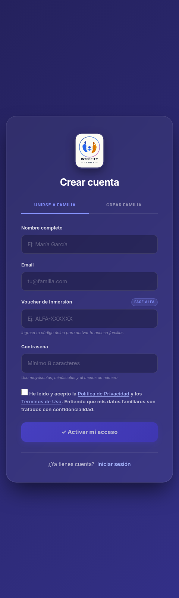
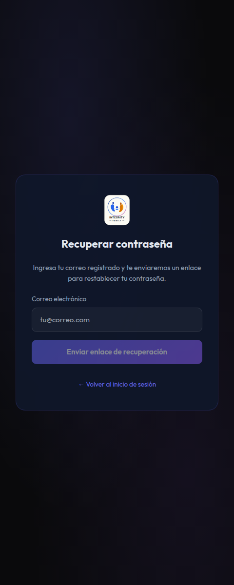
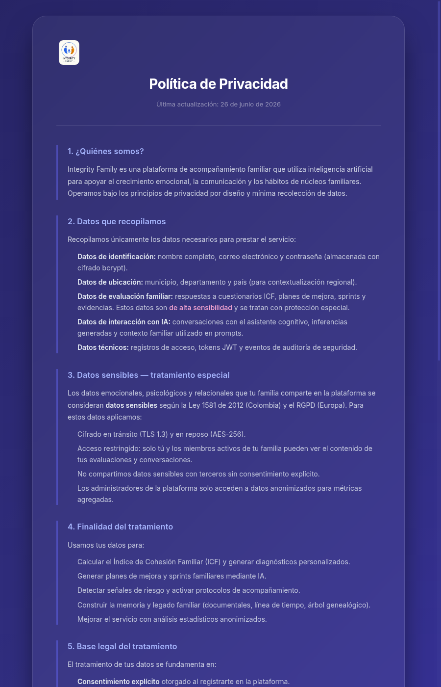

# PT-PS-01. Prototipado del Sistema Integrity Family

## Nombre del Proyecto

Integrity Family

## Número de versión

1.0 — 16/11/2026.

Este documento describe la arquitectura de información y las pantallas reales de la SPA Angular. No son bocetos de Balsamiq: son las vistas que declara `if-frontend/src/app/app.routes.ts` y el menú de `sidebar.component.ts`. Donde no hay captura, el espacio queda marcado. El entorno de documentación intentó instalar dependencias del frontend para tomar capturas; el resultado se actualiza al final de la sección 3 si el servidor llega a responder.

**HISTORIAL DE REVISIÓN**

| Versión | Fecha Elaboración | Responsable Elaboración | Fecha Aprobación | Responsable Aprobación |
| --- | --- | --- | --- | --- |
| 1.0 | 16/11/2026 | William Lopez | [Pendiente: fecha de aprobación del instructor] | [Pendiente: nombre del instructor] |

**CAMBIOS RESPECTO A LA VERSIÓN ANTERIOR**

| **VERSIÓN** | **MODIFICACIÓN RESPECTO VERSIÓN ANTERIOR** |
| --- | --- |
| 1.0 | Creación a partir de rutas, menú y plantillas Angular. |

## Tabla de Contenido.

1. Introducción
2. Arquitectura de información
3. Prototipos
4. Enlace del prototipo funcional

## 1. Introducción

La interfaz es una aplicación de una sola página. Las rutas públicas cubren lo legal y el acceso. El resto vive dentro de `ShellComponent`, protegido por `authGuard`. El menú cambia si la persona es profesional, si está observando una familia o si es administrador de plataforma. La ruta por defecto después de autenticarse es el Hogar Digital (`family-home`), decisión de ADR-002.

## 2. Arquitectura de Información

```mermaid
flowchart TD
  raiz[Integrity Family]
  raiz --> legal[Legal sin sesión]
  raiz --> acceso[Acceso sin sesión]
  raiz --> app[Aplicación autenticada]
  legal --> priv["/legal/privacy"]
  legal --> term["/legal/terms"]
  acceso --> login["/auth/login"]
  acceso --> reg["/auth/register"]
  acceso --> olvido["/auth/forgot-password"]
  acceso --> reset["/auth/reset-password"]
  app --> hogar["/family-home"]
  app --> diag[Diagnóstico]
  app --> plan[Plan y ruta]
  app --> dia[Transformación diaria]
  app --> apoyo[Apoyo]
  app --> legado[Legado]
  app --> sistema[Sistema]
  app --> admin[Administración]
  diag --> ev1["/evaluations/start"]
  diag --> ev2["/evaluations/history"]
  diag --> ev3["/evaluations/evolution"]
  diag --> ev4["/evaluations/analytics"]
  plan --> plans["/plans"]
  plan --> ruta["/transformation/route"]
  dia --> sprint["/sprint"]
  dia --> log["/logbook"]
  dia --> vita["/vitality"]
  dia --> evid["/checklist y /evidence/capture"]
  apoyo --> crisis["/crisis"]
  apoyo --> chat["/chat"]
  apoyo --> tray["/trajectory"]
  apoyo --> pro["/professional"]
  legado --> bio["/biography"]
  legado --> lin["/lineage"]
  sistema --> dash["/dashboard"]
  sistema --> perfil["/profile"]
  admin --> af["/admin/families"]
  admin --> st["/admin/stats"]
```

Etiquetas del menú familiar, copiadas de `sidebar.component.ts`:

| Bloque del menú | Etiqueta visible | Ruta |
| --- | --- | --- |
| Marca | SISTEMA OPERATIVO FAMILIAR | — |
| Inicio familiar | Hogar Digital | `/family-home` |
| Inicio profesional | HUD Clínico | `/hud` |
| CONFIGURACIÓN | Familia | `/families` |
| CONFIGURACIÓN | Miembros | `/members` |
| CONFIGURACIÓN | Guardián Familiar | `/guardian/:id/election` |
| CONFIGURACIÓN | ADN Familiar | `/family-dna` |
| DIAGNÓSTICO | Iniciar evaluación | `/evaluations/start` |
| DIAGNÓSTICO | Historial | `/evaluations/history` |
| DIAGNÓSTICO | Evolución | `/evaluations/evolution` |
| DIAGNÓSTICO | Panel Clínico | `/evaluations/analytics` |
| ÍNDICES | Capital Familiar — ICaF | `/capital` |
| ÍNDICES | Fortalecimiento — SMFF | `/smff` |
| PLAN & RUTA | Plan Familiar | `/plans` |
| PLAN & RUTA | Ruta de 36 Meses | `/transformation/route` |
| TRANSFORMACIÓN DIARIA | Sprint Familiar | `/sprint` |
| TRANSFORMACIÓN DIARIA | Bitácora & Daily | `/logbook` |
| TRANSFORMACIÓN DIARIA | Bienestar Biológico | `/vitality` |
| TRANSFORMACIÓN DIARIA | Planeación Mensual | `/transformation/weekly-plan` |
| TRANSFORMACIÓN DIARIA | Evidencias | `/checklist` |
| TRANSFORMACIÓN DIARIA | Cápsula Familiar | `/evidence/capture` |
| TRANSFORMACIÓN DIARIA | Gestión de Errores | `/transformation/error-protocol` |
| TRANSFORMACIÓN DIARIA | Motor Adaptativo | `/transformation/adaptive` |
| APOYO | Crisis Familiar | `/crisis` |
| APOYO | Reportes | `/reports` |
| APOYO | Consultor IA | `/chat` |
| APOYO | Sistema Cognitivo | `/cognitive` |
| APOYO | Documentación | `/documentation` |
| APOYO | Trayectorias de Riesgo | `/trajectory` |
| APOYO | Salud Familiar | `/health` |
| APOYO | Viaje Familiar | `/journey` |
| APOYO | Ecosistema de Apoyo | `/ecosystem` |
| APOYO | Panel Profesional | `/professional` |
| LEGADO | Rituales, documental, gratitud, Mi Espacio, legado, película, historia, árbol, linaje, biografía | `/rituals`, `/documentary-maker`, `/gratitude`, `/my-space`, `/legado`, `/family-movie`, `/family-timeline`, `/family-tree`, `/lineage`, `/biography` |
| SISTEMA | Gemelo Digital, Consejo, Pulso, Panel Analítico, Portal Móvil, Mi Perfil | `/digital-twin`, `/family-council`, `/family-pulse`, `/dashboard`, `/portal`, `/profile` |
| Administración, si `role === 'ADMIN'` | Familias Registradas, Estadísticas, Reglas EEDSL, Sandbox, Monitor Voz | `/admin/families`, `/admin/stats`, `/admin/eedsl`, `/admin/sandbox`, `/admin/voice-monitor` |

Cualquier ruta no declarada redirige a `/auth/login`.

## 3. Prototipos

El 16/11/2026 se sirvió el frontend con `ng serve` en el puerto 4300, sin backend. Las pantallas públicas sí se capturaron. Las que exigen sesión redirigen al acceso y quedan pendientes.

### 3.1. Acceso — Inicio de sesión

**Captura**

Escritorio:

Teléfono (ancho 390 px):

**Descripción**

Pantalla pública `LoginPageComponent`. Arriba está la marca «Integrity Family» y la frase «Preservando historias · Transformando generaciones». Pregunta «¿Y si tu familia pudiera crecer antes de que los problemas crezcan?» y muestra cuatro chips: Emociones, Comunicación, Tiempo juntos y Hábitos. Ofrece «Crear mi familia» y, debajo, el formulario «Ya tengo cuenta» con correo `tu@correo.com`, contraseña, «Recordar mis datos», «¿Olvidaste tu contraseña?» y el botón «Continuar nuestro proceso». Al pie cita: «Lo que una generación aprende, la siguiente no tiene que volver a sufrirlo.» Hay enlaces a Privacidad y Términos de uso. El envío valida correo y contraseña en el navegador y solo entonces llama al API. Los errores de credenciales, bloqueo o mantenimiento aparecen después de esa llamada.

### 3.2. Acceso — Registro

**Captura**

La ruta abre por defecto en la pestaña «Unirse a familia»:

[Pendiente: captura de la pestaña «Crear familia», que pide nombre del núcleo, municipio y departamento. El servidor de capturas no pulsó esa pestaña.]

**Descripción**

Título «Crear cuenta». Dos pestañas: «Unirse a familia» y «Crear familia». En la primera, el formulario pide nombre completo (ejemplo «Ej: María García»), correo, «Voucher de Inmersión» con la etiqueta «FASE ALFA» (ejemplo `ALFA-XXXXXX`) y contraseña de mínimo 8 caracteres, con mayúscula, minúscula y un número. La casilla dice «He leído y acepto la Política de Privacidad y los Términos de Uso. Entiendo que mis datos familiares son tratados con confidencialidad.» El botón es «Activar mi acceso» y no sigue sin esa aceptación. Crear familia, en la otra pestaña, pide además el nombre del núcleo, el municipio y el departamento.

### 3.3. Hogar Digital

**Captura**

[Pendiente: captura de `/family-home`.]

**Descripción**

Raíz autenticada. `FamilyHomePageComponent` muestra la etapa del hogar (incorporación, evaluación, activo o en pausa) y resúmenes de sprint y evaluación. El título de ruta es «Hogar Digital Familiar».

### 3.4. Evaluación

**Captura**

[Pendiente: captura de `/evaluations/start` y del formulario `/evaluations/:id/form`.]

**Descripción**

«Nueva Evaluación Premium» exige un pilar. El formulario presenta las frases de la Ruta de Conciencia, no los nombres internos de estado. Al cerrar, `/evaluations/:id/result` muestra el resultado. Historial, evolución, inferencias y panel clínico son rutas aparte.

### 3.5. Plan familiar

**Captura**

[Pendiente: captura de `/plans`.]

**Descripción**

«Portal de Transformación Familiar». Lista misiones, evidencia y el estado de aceptación del plan. Avisos de interfaz: «Dimensión completada» y «Plan completo». El detalle de una misión está en `/plans/mission/:taskId`.

### 3.6. Sprint familiar

**Captura**

[Pendiente: captura de `/sprint`.]

**Descripción**

Tablero del sprint activo, alta, daily y cierre. Mensajes de éxito: «Daily registrado. ¡Gracias por tu conciencia!», «Sprint creado. ¡El equipo está en marcha!» y «Sprint cerrado. ¡Excelente trabajo en equipo!»

### 3.7. Bitácora y Mi Espacio

**Captura**

[Pendiente: captura de `/logbook` y de `/my-space`.]

**Descripción**

La bitácora evolutiva mezcla entradas, sprint y retrospectiva. Mi Espacio guarda reflexiones privadas. No existe una ruta `/journal`: el diario privado vive en Mi Espacio.

### 3.8. Trayectorias y panel profesional

**Captura**

[Pendiente: captura de `/trajectory` y de `/professional`.]

**Descripción**

«Banco de Trayectorias de Riesgo» consulta el catálogo y la asignación familiar. El panel profesional tiene las pestañas «Mis Familias» y «Mi Perfil». En observación, la barra del shell indica «Modo Observador Clínico».

### 3.9. Biografía y vitalidad

**Captura**

[Pendiente: captura de `/biography` y de `/vitality`.]

**Descripción**

«Nuestra Historia» recorre capítulos y preguntas. «Bienestar Biológico» registra el día de forma parcial: ningún campo numérico es obligatorio en la base.

### 3.10. Administración

**Captura**

[Pendiente: captura del bloque admin, visible solo con rol `ADMIN` o con el correo fijado en el guard.]

**Descripción**

Familias registradas, estadísticas, reglas emocionales EEDSL, sandbox y monitor de voz. Un usuario sin ese rol que abra la URL es enviado a `/dashboard`.

### 3.11. Recuperar contraseña y política de privacidad

**Captura**

**Descripción**

«Recuperar contraseña» pide el correo registrado y el botón dice «Enviar enlace de recuperación». La política, con fecha «Última actualización: 26 de junio de 2026», declara datos de identificación, ubicación, evaluación, interacción con IA y datos técnicos, cita la Ley 1581 de 2012 y afirma cifrado TLS 1.3 y AES-256. Esa afirmación de cifrado en reposo no se comprobó en el código del backend; sigue pendiente en el PT-PP-01.

## 4. Enlace Prototipo funcional.

No hay un enlace de Figma ni de Balsamiq en el repositorio. El prototipo funcional es la propia SPA.

| Ambiente | Enlace | Fuente |
| --- | --- | --- |
| Desarrollo local | `http://localhost:4300` con `npm start` dentro de `if-frontend`. El README todavía dice el puerto 4200. | `if-frontend/package.json` |
| API local | `http://localhost:8080/swagger-ui.html` fuera de producción | `README.md`, `SecurityConfig` |
| Producción declarada del frontend | [Pendiente: URL de Vercel del proyecto. `environment.prod.ts` apunta la API a `https://if-backend-v1-0-0.onrender.com`.] | `if-frontend/src/environments/environment.prod.ts` |
| [Pendiente: URL pública vigente] | Confirmar si Render sigue siendo el host o si Railway lo reemplazó. Hay workflows para ambos. | `.github/workflows/deploy-backend.yml`, `deploy-backend-render.yml` |
