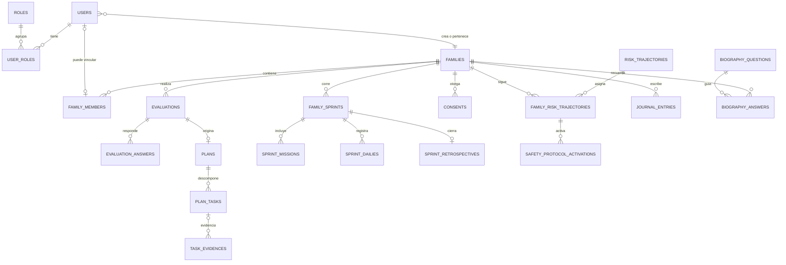

# PT-MCBD-01. Manual de Configuración de Base de Datos Integrity Family

## Nombre del Proyecto

Integrity Family

## Número de versión

1.0 — 16/11/2026. Esquema observado hasta la migración `V115`.

**HISTORIAL DE REVISIÓN**

| Versión | Fecha Elaboración | Responsable Elaboración | Fecha Aprobación | Responsable Aprobación |
| --- | --- | --- | --- | --- |
| 1.0 | 16/11/2026 | William Lopez | [Pendiente: fecha de aprobación del instructor] | [Pendiente: nombre del instructor] |

**CAMBIOS RESPECTO A LA VERSIÓN ANTERIOR**

| **VERSIÓN** | **MODIFICACIÓN RESPECTO VERSIÓN ANTERIOR** |
| --- | --- |
| 1.0 | Creación a partir de las entidades JPA y de `backend/src/main/resources/db/migration`. |

## Tabla de Contenido.

1. Introducción
2. Alcance
3. Modelo entidad relación
4. Diccionario de datos
5. Modelo relacional
6. Justificación del sistema gestor
7. Requisitos de configuración
8. Scripts
9. Configuración y ejecución
10. Otras consideraciones

## 1. Introducción

Integrity Family persiste el acompañamiento familiar en MySQL. El esquema no se mantiene a mano: Flyway aplica 113 scripts, de `V1__init_module1_schema.sql` a `V115__journal_entry_interpretation.sql`. Faltan los números `V61` y `V88`; no se deben reutilizar. Hay 122 entidades JPA. Este manual describe el núcleo relacional con el que opera el ciclo familia, evaluación, plan, sprint y evidencia, y cataloga el resto.

## 2. Alcance

Cubre la base `integrity_family` del compose local y la misma familia de scripts en el perfil que arranca Flyway. No cubre un segundo motor. No hay base documental: el producto es relacional. Los campos JSON que existen (`journal_entries.explicit_responses`, guiones de documental) viven dentro de MySQL.

Afecta al backend. El frontend no abre conexiones SQL.

## 3. Modelo Entidad Relación (MER)

Diagrama del ciclo principal. Los nombres son los de `@Table`. Se omiten decenas de tablas de apoyo para que el diagrama se lea; el catálogo completo está en la sección 5.



Relaciones que el código hace explícitas y que el diagrama resume:

- `users.family_id` apunta a `families` y es nulo para el administrador global (`User.java`).
- `families.created_by_id` apunta a `users`.
- `family_members.family_id` y `family_members.user_id` enlazan persona, núcleo y cuenta.
- `evaluations` pertenece a una familia y, si se conoce, a un miembro.
- `plans` es el plan de mejora (`ImprovementPlan`). `V111` le agrega la aceptación. La invariante de negocio es un plan activo por familia.
- `plan_tasks.responsible` apunta a un miembro.
- `task_evidences.task_id` es nulo desde `V65`. `documentary_id` es nulo desde `V67`.
- `safety_protocol_activations` exige un miembro responsable (`V98`).

## 4. Diccionario de Datos.

Tipos Java de las entidades. El nombre de columna físico sigue el `name` de `@Column` cuando existe; si no, Hibernate lo deriva en snake case. La nulabilidad que no está anotada queda como la definió la migración o `ddl-auto`, y por eso varias filas dicen «según migración».

### `families` — `Family`

| Campo | Tipo | Nulo | Descripción |
| --- | --- | --- | --- |
| id | BIGINT | No | Identificador. |
| name | VARCHAR | No | Nombre del núcleo. |
| description | TEXT | Sí | Texto libre. |
| family_code | VARCHAR | Sí | Código único. |
| pin | VARCHAR | Sí | PIN de ingreso. |
| current_milestone | VARCHAR | Sí | Hito vigente. Al crear, `W1`. |
| sentinel_active | BOOLEAN | Sí | Bandera del centinela. Defecto falso. |
| whatsapp | VARCHAR | Sí | Contacto. |
| municipio, country_code, department_code | VARCHAR | Sí | Ubicación. |
| created_by_id | BIGINT | Sí | Usuario creador. |
| guardian_member_id, guardian_since | BIGINT, fecha | Sí | Guardián elegido. |
| participation_score | INT | Sí | Puntaje de participación. Defecto 0. |
| milestone_started_at, milestone_icf_avg | fecha, DOUBLE | Sí | Cache del hito. |

### `users` — `User`

| Campo | Tipo | Nulo | Descripción |
| --- | --- | --- | --- |
| id | BIGINT | No | Identificador. |
| family_id | BIGINT | Sí | Familia. Nulo en el administrador global. |
| email | VARCHAR(180) | No | Único. |
| password_hash | VARCHAR(120) | No | BCrypt. |
| full_name | VARCHAR(150) | No | Nombre. |
| enabled | BOOLEAN | No | Cuenta habilitada. |
| account_locked_until | DATETIME | Sí | Fin del bloqueo. |
| last_login_at, created_at, updated_at | DATETIME | created y updated no | Auditoría de la cuenta. |

### `roles` y `user_roles`

| Tabla | Campo | Descripción |
| --- | --- | --- |
| roles | id, name | Nombre de rol (`ROLE_ADMIN`, `ROLE_USER`, `ROLE_FAMILY_ADMIN`, `ROLE_FAMILY_MEMBER`, `ROLE_THERAPIST`, `ROLE_ORIENTADOR`, `ROLE_SOCIAL_WORKER`). |
| user_roles | user_id, role_id | Unión muchos a muchos. |

### `family_members` — `FamilyMember`

| Campo | Tipo | Nulo | Descripción |
| --- | --- | --- | --- |
| id | BIGINT | No | Identificador. |
| family_id | BIGINT | Sí | Núcleo. |
| user_id | BIGINT | Sí | Cuenta vinculada. |
| full_name | VARCHAR | No | Nombre. |
| email | VARCHAR | Sí | Único si viene. |
| phone, role | VARCHAR | Sí | Contacto y rol familiar, distinto del rol Spring. |
| age | INT | Sí | Edad. Dato de menor si el valor es inferior a 18. |
| birth_date | DATE | Sí | Fecha de nacimiento. |
| document_type | VARCHAR(20) | Sí | CC, TI, RC, CE, PA, NUIP, PEP u otro. `V103`. |
| document_number | VARCHAR(30) | Sí | Número. Único junto con el tipo cuando ambos vienen. |
| active | BOOLEAN | No | Defecto verdadero. |
| autonomy_level, responsibility_level | INT | Sí | Niveles que el README llama autonomía y responsabilidad. |
| password | VARCHAR | Sí | Campo legado en la entidad. La clave de acceso vigente es `users.password_hash`. |
| joined_at | DATETIME | Sí | Alta. |

### `evaluations` — `Evaluation`

| Campo | Tipo | Nulo | Descripción |
| --- | --- | --- | --- |
| id | BIGINT | No | Identificador. |
| family, member | FK | familia requerida por el modelo | Quién evalúa. |
| status | enum | Según migración | Abierta o finalizada. |
| started_at, finalized_at | DATETIME | Sí | Tiempos. |
| icf | DOUBLE | Sí | Índice 0 a 100. |
| inc, somatic_awareness, emotional_awareness, cognitive_awareness, impulsive_awareness | DOUBLE | Sí | Componentes adicionales del motor. Hay más columnas en la entidad (la extracción listó 18 campos). |

Tablas hijas: `evaluation_answers` (pregunta, puntaje, dimensión) y `evaluation_dimension_scores` (nombre de dimensión y puntaje).

### `plans` — `ImprovementPlan` y `plan_tasks` — `PlanTask`

| Tabla | Campo | Descripción |
| --- | --- | --- |
| plans | family, evaluation | Núcleo y evaluación de origen. |
| plans | title, description, vision3y, ai_report, ai_generated_at | Propuesta, incluida la de IA. |
| plans | accepted_at, accepted_by, intention_statement | Aceptación. `V111`. |
| plan_tasks | plan, title, description, dimension, due_date | Tarea. |
| plan_tasks | responsible | Miembro responsable. |
| plan_tasks | milestone, periodicity_months, fase, riesgo_asociado, objetivo | Contexto metodológico. La entidad declara del orden de 21 campos. |

### `family_sprints`, `sprint_missions`, `sprint_dailies`, `sprint_retrospectives`

| Tabla | Campos relevantes | Descripción |
| --- | --- | --- |
| family_sprints | family, objective, risk_dimension, duration_days, start_date, end_date, status | Duración solo 7 o 15 en el servicio. |
| sprint_missions | sprint, description, status, completed_at | `status` es VARCHAR. Valores: `PENDING`, `COMPLETED`, `CHANGED_BY_AGREEMENT`, `POSTPONED`. |
| sprint_dailies | sprint, member_name, checkin_date, yesterday_text, today_text, blockages_text, resolution_text, emotional_indicator, attempt_status | `attempt_status` desde `V114`. NULL = no respondido. |
| sprint_retrospectives | sprint, what_went_well, tension_level | Una por sprint. |

### `task_evidences` — `TaskEvidence`

| Campo | Nulo | Descripción |
| --- | --- | --- |
| family | No en el modelo de negocio | Núcleo dueño. |
| task | Sí desde V65 | Tarea opcional. |
| documentary | Sí desde V67 | Documental opcional. |
| evidence_type, title, description, file_url, text_content, submitted_by, emotion, latitude | Mixto | Contenido. La entidad tiene del orden de 19 campos, incluida la longitud. |

### `journal_entries` — `JournalEntry`

Familia, miembro autor (`V112`), `perceived_event_key`, origen, emoción, tarea relacionada, título y reflexión. Desde `V115`: `interpretation`, `alternative_explanation`, `body_signal` y `explicit_responses` (JSON). La ausencia de una clave en el JSON significa que esa pregunta no se respondió.

### `consents` — `Consent`

`family_id`, `member_id`, `purpose`, `scope`, `grantee_reference`, `status`, correos y fechas de otorgamiento y de revocación, `expires_at`. Propósitos del código: compartir con ecosistema, con red de apoyo, interoperabilidad en salud e investigación.

### `risk_trajectories` y `safety_protocol_activations`

| Tabla | Campos | Descripción |
| --- | --- | --- |
| risk_trajectories | code, name, macrodomain, description, early_signals, potential_evolution, severity_default, requires_safety_protocol, contextual_criticality_rule, active | Banco. `V75` y `V97`. |
| safety_protocol_activations | family_trajectory, responsible, initial_action, follow_up_date, support_assignment, resolution_notes, activated_by, closed_at | Activación manual. `V98`. |

### `biography_questions`, `biography_answers`, `daily_vitality_logs`, `hypothesis_evidence`

| Tabla | Campos | Descripción |
| --- | --- | --- |
| biography_questions | chapter_number, chapter_title, question_key, prompt_text, deepen_text, sort_order | Catálogo global. El texto se siembra en Java. |
| biography_answers | family, member, question, answer_text, epistemic_source, visibility, perceived_event_key, confidence_level | Una por miembro y pregunta. |
| daily_vitality_logs | family_member, log_date, sleep_hours, sleep_quality, exercise_minutes, nutrition_quality, screen_time_before_bed_minutes, fatigue_level | Todos los numéricos aceptan NULL. `V110`. |
| hypothesis_evidence | hypothesis, hypothesis_version, subject_type, subject_id, measurement_type, measurement_value, instrument, source, observed_at | Append-only. `V106`. No es estado operacional. |

## 5. Modelo Relacional o Estructura de Documentos.

El modelo es relacional. No hay colección documental como almacén principal. A continuación, las 122 tablas que declaran las entidades. Una tabla física creada solo por SQL y sin entidad no aparece aquí; el inventario ejecutable sigue siendo la carpeta de migraciones.

| Tabla | Clase | Paquete |
| --- | --- | --- |
| `adaptive_adjustments` | `AdaptiveAdjustmentEntity` | `com.integrityfamily.adaptive` |
| `admin_alerts` | `AdminAlert` | `com.integrityfamily.domain` |
| `ai_inferences` | `AiInferenceEntity` | `com.integrityfamily.domain` |
| `alexa_oauth_codes` | `AlexaOAuthCode` | `com.integrityfamily.alexa.domain` |
| `alexa_oauth_tokens` | `AlexaOAuthToken` | `com.integrityfamily.alexa.domain` |
| `audit_events` | `AuditEvent` | `com.integrityfamily.domain` |
| `beta_feedback` | `Feedback` | `com.integrityfamily.domain` |
| `biography_answers` | `BiographyAnswer` | `com.integrityfamily.biography.domain` |
| `biography_questions` | `BiographyQuestion` | `com.integrityfamily.biography.domain` |
| `chat_messages` | `ChatMessage` | `com.integrityfamily.domain` |
| `checklist_items` | `ChecklistItem` | `com.integrityfamily.domain` |
| `checklist_logs` | `ChecklistLog` | `com.integrityfamily.domain` |
| `consents` | `Consent` | `com.integrityfamily.consent.domain` |
| `conversation_sessions` | `ConversationSession` | `com.integrityfamily.domain` |
| `critical_days` | `CriticalDay` | `com.integrityfamily.domain` |
| `daily_vitality_logs` | `DailyVitalityLog` | `com.integrityfamily.vitality.domain` |
| `documentary_productions` | `DocumentaryProduction` | `com.integrityfamily.documentary.domain` |
| `ecosystem_access_log` | `EcosystemAccessLog` | `com.integrityfamily.ecosystem.domain` |
| `ecosystem_participant_contacts` | `EcosystemParticipantContact` | `com.integrityfamily.ecosystem.domain` |
| `ecosystem_participants` | `EcosystemParticipant` | `com.integrityfamily.ecosystem.domain` |
| `emotional_rules` | `EmotionalRule` | `com.integrityfamily.scanner.domain` |
| `emotional_stimuli` | `EmotionalStimulus` | `com.integrityfamily.domain` |
| `evaluation_answers` | `EvaluationAnswer` | `com.integrityfamily.domain` |
| `evaluation_dimension_scores` | `EvaluationDimensionScore` | `com.integrityfamily.domain` |
| `evaluations` | `Evaluation` | `com.integrityfamily.domain` |
| `failed_login_attempts` | `FailedLoginAttempt` | `com.integrityfamily.domain` |
| `families` | `Family` | `com.integrityfamily.domain` |
| `family_action_executions` | `FamilyActionExecution` | `com.integrityfamily.domain` |
| `family_alerts` | `FamilyAlert` | `com.integrityfamily.scanner.domain` |
| `family_behavioral_events` | `FamilyBehavioralEvent` | `com.integrityfamily.domain` |
| `family_capital_snapshots` | `FamilyCapitalSnapshot` | `com.integrityfamily.domain` |
| `family_chapter_progress` | `FamilyChapterProgress` | `com.integrityfamily.domain` |
| `family_context_snapshots` | `FamilyContextSnapshot` | `com.integrityfamily.context.domain` |
| `family_critical_events` | `FamilyCriticalEvent` | `com.integrityfamily.domain` |
| `family_dashboard_views` | `FamilyDashboardView` | `com.integrityfamily.analytics.domain` |
| `family_dna` | `FamilyDna` | `com.integrityfamily.dna.domain` |
| `family_documentaries` | `FamilyDocumentary` | `com.integrityfamily.domain` |
| `family_ecosystem_links` | `FamilyEcosystemLink` | `com.integrityfamily.ecosystem.domain` |
| `family_error_protocols` | `FamilyErrorProtocol` | `com.integrityfamily.errorprotocol.domain` |
| `family_gratitude_entries` | `FamilyGratitudeEntry` | `com.integrityfamily.domain` |
| `family_icaf_answers` | `FamilyIcafAnswer` | `com.integrityfamily.domain` |
| `family_identity_profile` | `FamilyIdentityProfile` | `com.integrityfamily.domain` |
| `family_journey_snapshots` | `FamilyJourneySnapshot` | `com.integrityfamily.domain` |
| `family_legacies` | `FamilyLegacy` | `com.integrityfamily.legado.domain` |
| `family_lineages` | `FamilyLineage` | `com.integrityfamily.lineage.domain` |
| `family_logbook_entries` | `FamilyLogbookEntry` | `com.integrityfamily.domain` |
| `family_longitudinal_state` | `FamilyLongitudinalState` | `com.integrityfamily.domain` |
| `family_members` | `FamilyMember` | `com.integrityfamily.domain` |
| `family_memory` | `FamilyMemory` | `com.integrityfamily.domain` |
| `family_metrics_snapshots` | `FamilyMetricsSnapshot` | `com.integrityfamily.domain` |
| `family_missions` | `FamilyMission` | `com.integrityfamily.guardian.domain` |
| `family_movies` | `FamilyMovie` | `com.integrityfamily.movie.domain` |
| `family_predictions` | `FamilyPrediction` | `com.integrityfamily.twin.domain` |
| `family_risk_trajectories` | `FamilyRiskTrajectory` | `com.integrityfamily.domain` |
| `family_rituals` | `FamilyRitual` | `com.integrityfamily.ritual.domain` |
| `family_sprints` | `FamilySprint` | `com.integrityfamily.domain` |
| `family_support_assignments` | `FamilySupportAssignment` | `com.integrityfamily.support.domain` |
| `family_tree_links` | `FamilyTreeLink` | `com.integrityfamily.tree.domain` |
| `family_twin_profiles` | `FamilyTwinProfile` | `com.integrityfamily.twin.domain` |
| `family_values` | `FamilyValue` | `com.integrityfamily.legado.domain` |
| `generational_messages` | `GenerationalMessage` | `com.integrityfamily.tree.domain` |
| `guardian_votes` | `GuardianVote` | `com.integrityfamily.guardian.domain` |
| `hypothesis_evidence` | `HypothesisEvidence` | `com.integrityfamily.domain` |
| `inference_records` | `InferenceRecord` | `com.integrityfamily.scanner.domain` |
| `journal_entries` | `JournalEntry` | `com.integrityfamily.domain` |
| `learned_skills` | `LearnedSkill` | `com.integrityfamily.domain` |
| `learning_entries` | `LearningEntry` | `com.integrityfamily.domain` |
| `lineage_events` | `LineageEvent` | `com.integrityfamily.lineage.domain` |
| `lineage_generation_info` | `LineageGenerationInfo` | `com.integrityfamily.lineage.domain` |
| `lineage_members` | `LineageMember` | `com.integrityfamily.lineage.domain` |
| `lineage_relationships` | `LineageRelationship` | `com.integrityfamily.lineage.domain` |
| `lts_attempts` | `Attempt` | `com.integrityfamily.lts.domain` |
| `lts_comparisons` | `Comparison` | `com.integrityfamily.lts.domain` |
| `lts_corrections` | `Correction` | `com.integrityfamily.lts.domain` |
| `lts_errors` | `LearningError` | `com.integrityfamily.lts.domain` |
| `lts_hypotheses` | `Hypothesis` | `com.integrityfamily.lts.domain` |
| `lts_insights` | `Insight` | `com.integrityfamily.lts.domain` |
| `lts_sessions` | `LearningSession` | `com.integrityfamily.lts.domain` |
| `member_identity_profiles` | `MemberIdentityProfile` | `com.integrityfamily.domain` |
| `member_relation_edges` | `MemberRelationEdge` | `com.integrityfamily.domain` |
| `milestone_definitions` | `Milestone` | `com.integrityfamily.domain` |
| `mission_adjustments` | `MissionAdjustment` | `com.integrityfamily.domain` |
| `narrative_chapters` | `NarrativeChapter` | `com.integrityfamily.domain` |
| `notification_logs` | `NotificationLog` | `com.integrityfamily.common.domain` |
| `observatory_snapshots` | `ObservatorySnapshot` | `com.integrityfamily.domain` |
| `participation_events` | `ParticipationEvent` | `com.integrityfamily.domain` |
| `password_reset_tokens` | `PasswordResetToken` | `com.integrityfamily.domain` |
| `plan_adjustments` | `PlanAdjustment` | `com.integrityfamily.domain` |
| `plan_task_steps` | `PlanTaskStep` | `com.integrityfamily.domain` |
| `plan_tasks` | `PlanTask` | `com.integrityfamily.domain` |
| `plan_template_activities` | `PlanTemplateActivity` | `com.integrityfamily.domain` |
| `plan_templates` | `PlanTemplate` | `com.integrityfamily.domain` |
| `plans` | `ImprovementPlan` | `com.integrityfamily.domain` |
| `private_journal_entries` | `PrivateJournalEntry` | `com.integrityfamily.myspace.domain` |
| `professional_follow_up_drafts` | `ProfessionalFollowUpDraft` | `com.integrityfamily.support.domain` |
| `progress_snapshots` | `ProgressSnapshot` | `com.integrityfamily.analytics.domain` |
| `project_documents` | `ProjectDocument` | `com.integrityfamily.documentation.domain` |
| `question_options` | `QuestionOption` | `com.integrityfamily.domain` |
| `questions` | `Question` | `com.integrityfamily.domain` |
| `reflections` | `Reflection` | `com.integrityfamily.domain` |
| `reflective_sessions` | `ReflectiveSession` | `com.integrityfamily.domain` |
| `refresh_tokens` | `RefreshToken` | `com.integrityfamily.domain` |
| `risk_snapshots` | `RiskSnapshot` | `com.integrityfamily.domain` |
| `risk_trajectories` | `RiskTrajectory` | `com.integrityfamily.domain` |
| `roles` | `Role` | `com.integrityfamily.domain` |
| `safety_protocol_activations` | `SafetyProtocolActivation` | `com.integrityfamily.domain` |
| `sentiment_reports` | `SentimentReportEntity` | `com.integrityfamily.analytics.domain` |
| `sprint_dailies` | `SprintDaily` | `com.integrityfamily.domain` |
| `sprint_missions` | `SprintMission` | `com.integrityfamily.domain` |
| `sprint_retrospectives` | `SprintRetrospective` | `com.integrityfamily.domain` |
| `support_access_logs` | `SupportAccessLog` | `com.integrityfamily.support.domain` |
| `support_network_members` | `SupportNetworkMember` | `com.integrityfamily.support.domain` |
| `support_professional_notes` | `SupportProfessionalNote` | `com.integrityfamily.support.domain` |
| `task_evidences` | `TaskEvidence` | `com.integrityfamily.domain` |
| `trajectory_impact_indicators` | `TrajectoryImpactIndicator` | `com.integrityfamily.domain` |
| `trajectory_timeline_events` | `TrajectoryTimelineEvent` | `com.integrityfamily.domain` |
| `transformation_states` | `TransformationState` | `com.integrityfamily.transformation.domain` |
| `user_journals` | `UserJournal` | `com.integrityfamily.domain` |
| `users` | `User` | `com.integrityfamily.domain` |
| `voice_audits` | `VoiceAudit` | `com.integrityfamily.report.domain` |
| `weekly_plans` | `WeeklyPlan` | `com.integrityfamily.weeklyplan.domain` |
| `weekly_tasks` | `WeeklyTask` | `com.integrityfamily.weeklyplan.domain` |

Total: 122


## 6. Justificación Sistema gestor de bases de datos seleccionado

El repositorio no incluye el cuadro comparativo de la actividad SENA. La elección que sí está implementada es MySQL 8.4, y estas son las razones que el código muestra:

| Criterio | MySQL 8.4 en este proyecto | Otro motor |
| --- | --- | --- |
| Relación con el acceso | Spring Data JPA y el dialecto MySQL ya están en `pom.xml` (`mysql-connector-j`, Flyway MySQL). | Cambiar de motor obliga a reescribir 113 migraciones. |
| Integridad | Llaves foráneas, únicos (`email`, `family_code`, documento) y transacciones de los servicios. | Un documento flexible no expresa la pertenencia familiar que `SecurityValidator` exige. |
| Evolución | Flyway versiona cada cambio, incluidos los huecos V61 y V88 que no se rellenan. | Un esquema solo por `ddl-auto` ya mostró columnas huérfanas; `V68` y `V112` existen para formalizarlas. |
| Operación local | Imagen oficial `mysql:8.4` en Compose, puerto anfitrión 3307. | H2 se usa únicamente en el perfil `test`. |
| JSON puntual | `explicit_responses` cabe en una columna JSON sin salir de MySQL. | No hace falta un segundo gestor. |

[Pendiente: cuadro comparativo con PostgreSQL, SQL Server y MongoDB exigido por el instructor, con fuentes y la firma del equipo.]

## 7. Requisitos de Configuración

| Pieza | Versión observada | Uso |
| --- | --- | --- |
| MySQL | 8.4 (`docker-compose.yml`) | Motor. |
| Cliente | El que prefiera el equipo (mysql CLI, MySQL Workbench, DBeaver). No está fijado en el repo. | Consulta. |
| Flyway | El que trae Spring Boot 3.4.3 (`flyway-core`, `flyway-mysql`) | Migración al arrancar. |
| Puerto local | 3307 en el anfitrión, 3306 en el contenedor | `docker-compose.yml`. |
| Base | `integrity_family` | Variable `MYSQL_DATABASE`. |
| Usuario local de compose | `root` | La contraseña está en el compose de desarrollo. No se copia a un manual de producción. |
| Zona | `America/Bogota` en la URL JDBC del compose | Evita desfases de `DATETIME`. |

## 8. Scripts

Los scripts de creación son los 113 archivos de `backend/src/main/resources/db/migration/`. No se reproduce aquí el SQL de producción: pegarlo duplicaría el esquema y se desalinea en la siguiente migración. El arranque los aplica en orden.

Fragmento real de `V103__family_member_identification.sql`. Las columnas nacen nulas para no bloquear miembros ya guardados, y el índice único no choca con los NULL:

```sql
ALTER TABLE family_members
    ADD COLUMN document_type   VARCHAR(20) NULL AFTER birth_date,
    ADD COLUMN document_number VARCHAR(30) NULL AFTER document_type;

CREATE UNIQUE INDEX uk_family_members_document
    ON family_members (document_type, document_number);
```

Otras migraciones, cuando necesitan idempotencia en MySQL 8, usan un procedimiento sobre `information_schema` porque `ADD COLUMN IF NOT EXISTS` es sintaxis de MariaDB (`CLAUDE.md`). Antes de citar un script en la sustentación, abrir el archivo V correspondiente.

Comandos de inspección:

```sql
SELECT version, description, success
FROM flyway_schema_history
ORDER BY installed_rank;
```

```sql
SHOW TABLES;
```

## 9. Configuración y Ejecución de la Base de Datos

1. Instalar Docker. El compose no instala MySQL en el sistema anfitrión.
2. En la raíz del repositorio, copiar `.env.example` a `.env` y completar `DB_PASSWORD`, `JWT_SECRET` y `FAMILY_HOME_ID_SECRET`. [Pendiente: valores que entregue el instructor; no se documentan secretos reales.]
3. Levantar solo la base:

```bash
docker compose up -d db
```

4. Esperar el healthcheck (`mysqladmin ping`). El puerto publicado es `localhost:3307`.
5. Comprobar:

```bash
docker compose exec db mysql -uroot -proot123 -e "SHOW DATABASES;"
```

La contraseña `root123` es la del compose de desarrollo, visible en el archivo. No sirve para producción.

6. Arrancar el backend con el perfil que tenga Flyway encendido. Al subir, Flyway crea `flyway_schema_history` y aplica cada script pendiente. El backend del compose usa el perfil `prod` y la URL `jdbc:mysql://db:3306/integrity_family`.
7. Verificar la última versión:

```bash
docker compose exec db mysql -uroot -proot123 integrity_family \
  -e "SELECT version, description, success FROM flyway_schema_history ORDER BY installed_rank DESC LIMIT 5;"
```

El resultado esperado en esta rama es ver `115` con descripción de interpretación del diario, y no ver versiones `61` ni `88`.

Copia de seguridad: `scripts/backup-mysql.sh`. Restauración: `scripts/restore-mysql.sh`. El procedimiento verificado el 2026-06-16 está en `CLAUDE.md` y en `docs/backup-restore.md`.

## 10. Otras Consideraciones

- No editar un script ya aplicado. El siguiente número es V116.
- `ddl-auto` por defecto es `update`. En un entorno que deba obedecer solo a Flyway, definir `JPA_DDL_AUTO=validate`. `application-prod.yml` y el bloque embebido del perfil prod no dicen lo mismo: uno usa `update` y la guía interna menciona `validate`. [Pendiente: unificar el valor de producción.]
- El perfil `test` no usa esta base: usa H2 y Flyway apagado.
- El perfil `integration-test` crea `integrity_family_e2e_test` contra el MySQL del puerto 3307.
- `hypothesis_evidence` no se actualiza: es append-only por diseño del ADR-004.
- Datos de menores y de documento viven en `family_members`. El backup contiene datos personales. [Pendiente: política de cifrado del archivo de backup y de quién puede restaurarlo.]
