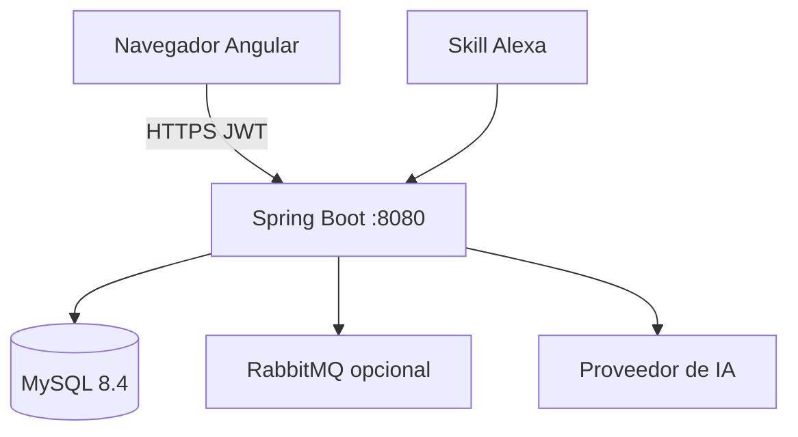

# PT-MTC-01. Manual Técnico de Configuración Integrity Family

## Nombre del Proyecto

Integrity Family

## Número de versión

1.0 — 16/11/2026. Rama `feature/v1.2-micro-simulations`, commit `0d3cfef`.

**HISTORIAL DE REVISIÓN**

| Versión | Fecha Elaboración | Responsable Elaboración | Fecha Aprobación | Responsable Aprobación |
| --- | --- | --- | --- | --- |
| 1.0 | 16/11/2026 | William Lopez | [Pendiente: fecha de aprobación del instructor] | [Pendiente: nombre del instructor] |

**CAMBIOS RESPECTO A LA VERSIÓN ANTERIOR**

| **VERSIÓN** | **MODIFICACIÓN RESPECTO VERSIÓN ANTERIOR** |
| --- | --- |
| 1.0 | Creación a partir de `pom.xml`, `package.json`, Docker, workflows y `docs/architecture.md`. |

## Tabla de Contenido.

1. Introducción
2. Alcance
3. Definiciones, siglas y abreviaturas
4. Aspectos técnicos
5. Requisitos de configuración
6. Proceso de configuración o despliegue
7. Ingreso al sistema
8. Otras consideraciones

## 1. Introducción

Este manual explica cómo está armado Integrity Family y cómo se levanta en local. El sistema ya está escrito: no es una guía para construirlo desde cero, sino para configurarlo a partir del repositorio.

## 2. Alcance

Cubre el backend Spring Boot, el frontend Angular, MySQL, RabbitMQ opcional y los archivos de despliegue a Railway, Render y Vercel. No cubre la compra de dominios ni las cuentas de esos proveedores. [Pendiente: accesos institucionales a Railway, Render, Vercel y Anthropic.]

El manual de la base está en el PT-MCBD-01. El uso de las pantallas está en el PT-MU-01.

## 3. Definiciones, siglas y abreviaturas

| Término | Significado en este repositorio |
| --- | --- |
| ICF | Índice de Cohesión Familiar, 0 a 100, cuatro dimensiones: emociones, comunicación, hábitos y tiempos (`docs/vision.md`). |
| ICaF | Índice de capital familiar. Pantalla `/capital` y módulo `capital`. |
| Ruta de Conciencia | Escala única de respuesta: cinco frases, estados internos no visibles (`rutaConcienciaDomain.ts`). |
| Hogar Digital | Raíz de la experiencia autenticada, ruta `/family-home` (ADR-002). |
| Sprint | Ciclo de 7 o 15 días con misiones, daily y retrospectiva. |
| ADR | Architecture Decision Record en `docs/adr/`. |
| JWT | Token de acceso emitido por `JwtTokenProvider`. |
| Flyway | Migraciones `V1` a `V115`. |
| FHIR | Representación R4 de solo lectura. El dominio no depende de las clases HAPI. |
| ROLE_ADMIN | Administrador de plataforma. |
| ROLE_FAMILY_ADMIN | Quien registra la familia. |
| SMFF | Panel de fortalecimiento familiar, ruta `/smff`. |
| EEDSL | Reglas emocionales de administración, ruta `/admin/eedsl`. |

## 4. Aspectos Técnicos

Características que el código fija:

| Aspecto | Valor |
| --- | --- |
| Compilación Java | 17 (`pom.xml`) |
| Ejecución en Docker | Temurin 21 (`backend/Dockerfile`) |
| Spring Boot | 3.4.3 |
| Angular | 17.3 |
| TypeScript | 5.4 |
| MySQL | 8.4 |
| Memoria y disco mínimos | [Pendiente: el repositorio no publica un requisito de RAM ni de disco. El compose local más el build de Maven superan holgadamente un equipo de 4 GB durante la compilación.] |
| Sistema operativo de desarrollo | El compose es Linux. Hay scripts `.bat` y `.ps1` en la raíz para Windows. [Pendiente: matriz de sistemas probados por el equipo.] |

### 4.1. Metodología de trabajo usada.

El repositorio no declara RUP ni un tablero Scrum con actas. Lo que sí se observa es un desarrollo iterativo: diecinueve ADR, migraciones numeradas, pilotos descritos en `docs/Directriz_Operativa_Piloto_V1.1.md` y `docs/Directriz_Operativa_Piloto_V1.2.md`, y una suite de pruebas JUnit que acompaña los servicios. La directriz V1.2 congela las fases del instrumento mientras el piloto está abierto. Eso es control de cambio sobre el método, no un marco de gestión con roles de Scrum escritos.

[Pendiente: el equipo debe indicar la metodología que exige el centro (híbrida RUP y Scrum, u otra) y aportar las actas. Este manual no la inventa.]

### 4.2. Tipo de Software o Enfoque tecnológico.

Aplicación web. El navegador ejecuta una SPA Angular. No hay APK ni cliente de escritorio en el repositorio. La ruta `/portal` es una vista móvil dentro de la misma SPA. Alexa es una integración HTTP opcional, no una segunda aplicación.

### 4.2. Arquitectura tecnológica.

Monolito modular. Un proceso Spring Boot agrupa los paquetes (`auth`, `family`, `evaluation`, `plan`, `bitacora`, `trajectory`, `consent`, `interop`, y el resto listado en `CLAUDE.md`). No hay un repositorio de microservicios.

Capas observadas en el código:

| Capa | Dónde |
| --- | --- |
| Interfaz | `if-frontend/src/app`, rutas en `app.routes.ts` |
| API | Controladores REST, 77 clases |
| Aplicación | Servicios por paquete |
| Dominio | Entidades en `domain` y en `*.domain` de cada módulo |
| Persistencia | Repositorios Spring Data y Flyway |
| Seguridad | `SecurityConfig`, filtro JWT, `SecurityValidator`, `FamilySecurityEvaluator` |
| Integración | RabbitMQ, proveedores de IA, HAPI FHIR, Alexa, correo |
| Despliegue | Docker, Railway, Render, Vercel |



`docs/architecture.md` dibuja el mismo recorrido y nombra Railway, CloudAMQP y Vercel. `render.yaml` y `deploy-backend-render.yml` muestran un segundo destino de la API. Las dos vías están en el repositorio; cuál está vigente en producción no se puede decidir solo con los archivos. [Pendiente: host real de la API en la fecha de sustentación.]

### 4.3. Patrones de Diseño usados.

| Patrón | Dónde se ve |
| --- | --- |
| Capas controlador, servicio y repositorio | Paquetes Java |
| DTO de entrada con Bean Validation | `auth/dto`, `consent/dto`, `member/dto` |
| Filtro de cadena (JWT) | `JwtAuthenticationFilter` delante del filtro de usuario y contraseña |
| Estrategia de proveedor de IA | `AiProviderSelector` (`docs/architecture.md`) |
| Mapeador puro | `interop/mapper`, sin acceso a base |
| Ensamblador | `CanonicalFamilyRecordAssembler`, `FhirBundleAssembler` |
| Publicación de eventos | `EventPublisher` y consumidores Rabbit, con el fallo contenido |
| Idempotencia | `family_action_executions` (`V102`) |
| Append-only de evidencia de hipótesis | `hypothesis_evidence` (ADR-004) |
| Inyección de dependencias | Constructores de Spring y Lombok `@RequiredArgsConstructor` |

### 4.4. Gestión de Datos.

Solo base relacional. MySQL guarda el estado operacional y también la evidencia de hipótesis, en una tabla aparte que no se actualiza. El detalle, el diccionario y la justificación del motor están en el PT-MCBD-01. H2 aparece únicamente para pruebas unitarias.

## 5. Requisitos de Configuración

| Herramienta | Versión en el repo | Obligatorio para |
| --- | --- | --- |
| JDK | 17 para compilar como dice Maven; 21 está en el host de este análisis y en la imagen Docker | Backend |
| Maven | El wrapper no se verificó; el Dockerfile usa Maven 3.9 | Backend |
| Node.js | El frontend declara Angular 17. Este entorno usó Node 22 | Frontend |
| Docker y Compose | Compose v2, imágenes `mysql:8.4` y `rabbitmq:3-management` | Local |
| Navegador actual | [Pendiente: lista certificada] | Uso |
| Variables | Nombres en `.env.example`: `DB_HOST`, `DB_PORT`, `DB_NAME`, `DB_USER`, `DB_PASSWORD`, `RABBITMQ_HOST`, `RABBITMQ_USER`, `RABBITMQ_PASSWORD`, `JWT_SECRET`, `JWT_EXPIRATION_MS`, `FAMILY_HOME_ID_SECRET`, `APP_CORS_ALLOWED_ORIGINS`, `CLAUDE_API_KEY`, `CLAUDE_MODEL`, `OPENAI_API_KEY`, `ELEVENLABS_*`, `WHISPER_*`, `SPRING_PROFILES_ACTIVE` | Arranque |
| IDE | No está fijado | Desarrollo |

`JWT_SECRET` no tiene valor por defecto en `application.yml`. Sin esa variable el contexto de seguridad no arranca.

## 6. Proceso de Configuración o Despliegue

### Local con Docker

1. Clonar el repositorio. El remoto observado es `Guillermo-prog-star/.-`. `CLAUDE.md` y comentarios antiguos dicen `if-full`. [Pendiente: URL pública que el equipo quiera citar.]
2. Crear `.env` desde `.env.example`. Completar secreto JWT, secreto del hogar y, si se va a usar IA real, `CLAUDE_API_KEY`.
3. En la raíz:

```bash
docker compose up -d db rabbitmq
```

4. Backend, en otra terminal, con Java 17 o superior y las variables exportadas:

```bash
cd backend
mvn spring-boot:run
```

5. Frontend:

```bash
cd if-frontend
npm ci --legacy-peer-deps
npm start
```

`npm start` publica `http://localhost:4300` y usa `proxy.conf.js`. El README dice el puerto 4200 y una carpeta `infra/` que no es la del compose de la raíz. Para este repositorio manda `docker-compose.yml` de la raíz y el puerto 4300.

6. Salud: `http://localhost:8080/actuator/health`. OpenAPI, si el perfil no es el que lo apaga: `http://localhost:8080/swagger-ui.html`.

El servicio `backend` del compose construye `backend/Dockerfile`, espera la salud de MySQL y de RabbitMQ, y publica el puerto 8080. Exige `JWT_SECRET`, `FAMILY_HOME_ID_SECRET` y `CLAUDE_API_KEY` en el entorno.

### Despliegue ya declarado

| Destino | Disparador | Archivo |
| --- | --- | --- |
| Pruebas y SonarCloud | Pull request o push a `main` o `principal` con cambios en `backend/` | `.github/workflows/quality.yml` |
| Railway | Push a `main` con cambios en `backend/` | `deploy-backend.yml`, `railway.json` (builder Dockerfile) |
| Render | Push a `main` con cambios en `backend/` | `deploy-backend-render.yml`, `render.yaml` (`RABBITMQ_ENABLED=false`, salud `/actuator/health`) |
| Vercel | Push a `principal` con cambios en `if-frontend/` | `deploy-frontend.yml`, `if-frontend/vercel.json` |

[Pendiente: secretos `SONAR_TOKEN` y tokens de Railway, Render y Vercel en GitHub. No se listan los valores.]

## 7. Ingreso al Sistema

Con el frontend en marcha, la entrada es `/auth/login`. Sin token, cualquier ruta privada vuelve ahí. El flujo de pantallas, los errores y los roles están en el PT-MU-01.

El inicializador, fuera del perfil `test`, asegura un administrador de plataforma. El correo y el nombre están en `MasterDataInitializer`: `william@integrity.family`, «William Lopez». La contraseña está en el mismo fuente y no se copia en este manual. Hay que rotarla antes de exponer el servicio. El README publica otro par de demostración (`admin@integrityfamily.com`). Los dos textos no coinciden. [Pendiente: decidir cuál credencial de aula se usa y sacar la clave del código.]

Resultado esperado del arranque sano: `actuator/health` en estado UP, la pantalla de login visible y, tras autenticarse, el Hogar Digital.

## 8. Otras Consideraciones

- Puerto 3306 ocupado en el anfitrión: el compose ya publica 3307. No hace falta cambiarlo si no hay otro MySQL en 3307.
- Flyway falla si se alteró un script aplicado. No se repara editando el archivo viejo; se agrega una migración nueva. El procedimiento de emergencia del README (borrar la base) destruye datos y solo cabe en local.
- RabbitMQ puede estar apagado (`RABBITMQ_ENABLED=false`). El producto debe seguir respondiendo HTTP.
- CORS sale de `APP_CORS_ALLOWED_ORIGINS`. Si el navegador llama otro origen, el login parece fallar en el cliente.
- `SERVER_ERROR_INCLUDE_MESSAGE` controla cuánto detalle de error sale. En producción no conviene devolver la excepción cruda. El manejador global antepone «Error interno en el sistema: » al mensaje de la excepción.
- Perfil `voice` activa banderas de voz. Sin claves de Whisper o ElevenLabs esa vía no opera.
- La política de privacidad afirma TLS 1.3 y AES-256. El código muestra BCrypt y JWT. [Pendiente: evidenciar el cifrado del disco y el certificado del host.]
