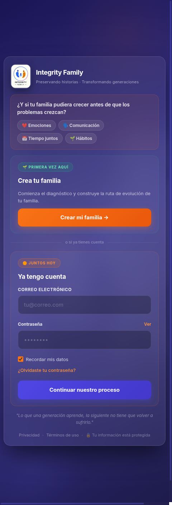
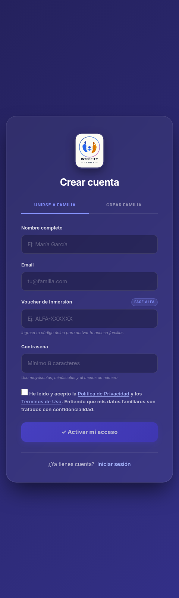
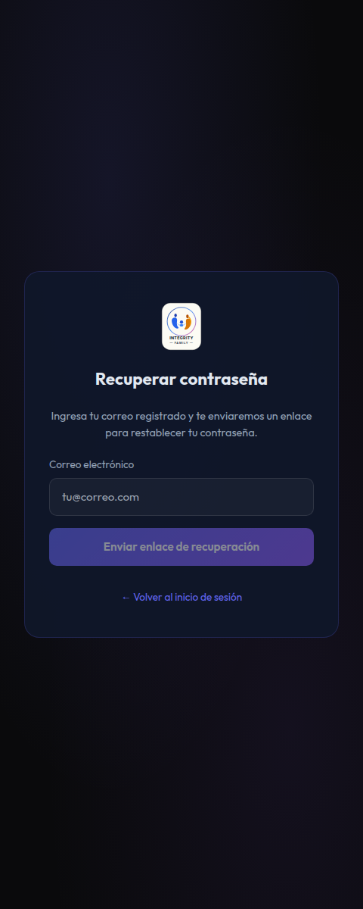

# PT-MU-01. Manual de usuario — Familia, profesional y administración

## Manual de usuario Familia, profesional y administración

Integrity Family

Número de versión: 1.0 — 16/11/2026

Un solo manual cubre los tres tipos de persona porque comparten la misma entrada y el menú cambia según el rol. Cada opción indica quién la ve. Las acciones de administración no se presentan como si cualquier miembro pudiera hacerlas.

**HISTORIAL DE REVISIÓN**

| Versión | Fecha Elaboración | Responsable Elaboración | Fecha Aprobación | Responsable Aprobación |
| --- | --- | --- | --- | --- |
| 1.0 | 16/11/2026 | William Lopez | [Pendiente: fecha de aprobación del instructor] | [Pendiente: nombre del instructor] |

**CAMBIOS RESPECTO A LA VERSIÓN ANTERIOR**

| **VERSIÓN** | **MODIFICACIÓN RESPECTO VERSIÓN ANTERIOR** |
| --- | --- |
| 1.0 | Creación a partir de rutas, menú y mensajes literales del frontend y del manejador global. |

## Tabla de Contenido.

1. Introducción
2. Alcance
3. Definiciones, siglas y abreviaturas
4. Responsables e involucrados
5. Roles y usuarios
6. Ingreso al sistema
7. Navegación
8. Opciones, módulos o funcionalidades
9. Mensajes

## 1. Introducción

Integrity Family es el lugar donde una familia reconoce cómo está conviviendo, acuerda un plan y deja constancia de lo que intenta. Este manual explica las pantallas que ya existen. No promete funciones que el menú no muestra.

## 2. Alcance

Sirve para quien usa el navegador: visitante, administrador familiar, miembro, profesional y administrador de plataforma. No explica la instalación del servidor; eso está en el PT-MTC-01. No sustituye la política de privacidad publicada en la propia aplicación.

## 3. Definiciones, Siglas y Abreviaturas

| Término | Qué significa para quien usa la pantalla |
| --- | --- |
| ICF | Índice de Cohesión Familiar. Un número de 0 a 100 en emociones, comunicación, hábitos y tiempos. Orienta. No es una etiqueta de la familia. |
| Hogar Digital | Primera pantalla después de entrar. Resume la etapa de la familia. |
| Sprint | Periodo de 7 o 15 días con misiones y un registro diario. |
| Daily | Registro del día dentro del sprint. |
| Ruta de Conciencia | Forma de responder: frases sobre qué tan presente está algo en la familia, no una escala de «nunca / siempre». |
| Evidencia | Prueba de lo que se hizo. Es distinta de marcar la misión como terminada. |
| Protocolo de seguridad | Acción humana ante una trayectoria grave, con responsable y fecha de seguimiento. No se abre solo. |
| Voucher | Código para unirse a una familia que ya existe. |

## 4. Responsables e involucrados

| **Nombre** | **Tipo (Responsable/ Involucrado)** | **Rol** |
| --- | --- | --- |
| William Lopez | Responsable | Autor registrado del repositorio |
| [Pendiente: equipo] | Responsable | [Pendiente: rol] |
| [Pendiente: instructor] | Involucrado | Aprobación del manual |
| Familia usuaria | Involucrado | Uso del hogar, la evaluación y el sprint |
| Profesional de apoyo | Involucrado | Panel profesional |

## 5. Roles y Usuarios

### 5.1 Usuarios

- Visitante, sin cuenta.
- Persona que crea una familia.
- Persona que se une con voucher.
- Miembro que ya pertenece al núcleo.
- Profesional (terapeuta, orientador o trabajador social).
- Administrador de la plataforma.

### 5.2 Roles

| Rol en el sistema | Qué puede hacer | Qué no hace en el menú |
| --- | --- | --- |
| Sin sesión | Ver política, términos, registro y recuperación. | No ve el Hogar ni el menú. |
| Administrador familiar (`ROLE_FAMILY_ADMIN`) | Menú completo de familia: miembros, evaluación, plan, sprint, evidencias, consentimiento. | No ve el bloque de administración de plataforma. |
| Miembro | Evaluación, daily, diario, biografía y evidencias de su núcleo. | El servidor rechaza otra familia. |
| Profesional | Entra a «Panel Profesional». Si observa una familia, el menú pasa a evolución, historial, ICaF, plan, salud, trayectorias y ecosistema. | No administra reglas EEDSL ni el sandbox. |
| Administrador de plataforma (`ROLE_ADMIN`) | Además del acceso que el servidor le concede, el menú muestra Familias Registradas, Estadísticas, Reglas EEDSL, Sandbox y Monitor Voz. | El frontend también trata como administrador el correo fijado en el guard. [Pendiente: decidir si ese correo sigue en el producto.] |

## 6. Ingreso al Sistema

1. Abra la dirección del ambiente. En local, con `npm start`, es `http://localhost:4300`. [Pendiente: dirección pública vigente.]
2. Si no hay sesión, la aplicación muestra el inicio de sesión (`/auth/login`). El título de la pestaña es «Integrity - Login».

3. Escriba el correo y la contraseña. Ambos son obligatorios. El botón dice «Continuar nuestro proceso» y, mientras envía, «Ingresando...». En la misma pantalla hay un botón «Crear mi familia» y el enlace «¿Olvidaste tu contraseña?».
4. Si entra un profesional, la siguiente pantalla es el panel profesional. Si entra una familia, la siguiente es el Hogar Digital.
5. Para crear una familia: «Crear mi familia» o `/auth/register`, pestaña «Crear familia». Pide datos personales, nombre del núcleo, municipio, departamento y aceptación de la política. Sin esa aceptación el envío no sigue.
6. Para unirse a una familia existente: la pestaña «Unirse a familia» es la que abre por defecto. Pide el «Voucher de Inmersión» (la pantalla lo marca «FASE ALFA») y el botón dice «Activar mi acceso».
7. Para olvidar la contraseña: «Recuperar contraseña», correo, y el aviso de revisar el correo. El enlace de la nueva contraseña caduca; la pantalla lo llama inválido o expirado si ya no sirve. La clave nueva necesita 8 caracteres, con mayúscula, minúscula y número.
8. Para salir: «Cerrar Sesión». La aplicación pregunta «¿Finalizar sesión?» y ofrece «Sí» o «No».

[Pendiente: capturas del ingreso. Ver PT-PS-01.]

## 7. Navegación

La marca del menú lateral dice «SISTEMA OPERATIVO FAMILIAR». Debajo, la familia ve «Hogar Digital» y el profesional ve «HUD Clínico».

El menú familiar agrupa:

- CONFIGURACIÓN: Familia, Miembros, Guardián Familiar, ADN Familiar.
- DIAGNÓSTICO: Iniciar evaluación, Historial, Evolución, Panel Clínico.
- ÍNDICES: Capital Familiar — ICaF, Fortalecimiento — SMFF.
- PLAN & RUTA: Plan Familiar, Ruta de 36 Meses.
- TRANSFORMACIÓN DIARIA: Sprint Familiar, Bitácora & Daily, Bienestar Biológico, Planeación Mensual, Evidencias, Cápsula Familiar, Gestión de Errores, Motor Adaptativo.
- APOYO: Crisis Familiar, Reportes, Consultor IA, Sistema Cognitivo, Documentación, Trayectorias de Riesgo, Salud Familiar, Viaje Familiar, Ecosistema de Apoyo, Panel Profesional.
- LEGADO: rituales, documental, gratitud, Mi Espacio, legado, película, historia, árbol, linaje y biografía.
- SISTEMA: Gemelo Digital, Consejo Familiar, Pulso Familiar, Panel Analítico, Portal Móvil, Mi Perfil.

La barra superior muestra la familia activa, a veces el sprint (lleva a la bitácora) y el perfil. No hay un segundo menú de módulos.

Quien observa como profesional ve «← Volver al Panel» y el aviso «Modo Observador Clínico». Una alerta del centinela, cuando el shell la muestra, dice «Alerta Sentinel: Se requiere intervención en red Alfa».

## 8. Opciones, Módulos o Funcionalidades

### 8.1 Familia y miembros

Quién: administrador familiar.

Dónde: «Familia» y «Miembros».

Puede crear el núcleo (nombre, ubicación, WhatsApp y PIN cuando el formulario los pide) y registrar personas. El nombre del miembro es obligatorio. El teléfono, si se escribe, debe tener 10 dígitos. La edad, la fecha de nacimiento y el documento son opcionales y son datos personales; la política de privacidad explica el trato.

### 8.2 Evaluación

Quién: miembro o administrador familiar.

Dónde: «Iniciar evaluación».

Elija un pilar. Responda con las frases que presenta la pantalla. Esas frases describen el grado de conciencia, no cuántas veces ocurre algo. Al terminar, el sistema calcula el ICF. Luego puede abrir Historial, Evolución y Panel Clínico. Si el servidor tarda, la pantalla ofrece «Intentar de nuevo».

### 8.3 Plan familiar

Quién: la familia decide; la IA solo propone el texto.

Dónde: «Plan Familiar».

Lea las misiones, el responsable y la dimensión. Acepte el plan cuando esté de acuerdo: sin esa aceptación el plan no queda confirmado por la familia. Marcar una misión como hecha no sustituye la evidencia.

### 8.4 Sprint y daily

Quién: el administrador familiar abre el sprint; el miembro registra el día.

Dónde: «Sprint Familiar» o «Bitácora & Daily».

La duración es de 7 o 15 días. Cada misión puede quedar pendiente, cumplida, cambiada por acuerdo o pospuesta. Las dos últimas no se cuentan como incumplimiento. En el daily se distingue si no hubo oportunidad, si no se intentó o si se intentó con o sin resultado favorable. Solo hay un daily por persona y por día.

### 8.5 Evidencias y cápsula

Quién: miembro.

Dónde: «Evidencias» y «Cápsula Familiar».

Puede dejar texto, archivo, emoción o lugar. Puede existir aunque la misión no esté cerrada. Quien revisa puede validar o rechazar. Un comentario automático no es una calificación.

### 8.6 Diario, bitácora y biografía

Quién: miembro.

Dónde: «Bitácora & Daily», «Mi Espacio» y «Nuestra Historia» (`/biography`).

La bitácora es del núcleo. Mi Espacio es privado: pide título y contenido. La biografía recorre capítulos con preguntas fijas. Puede borrar una respuesta; la pantalla advierte que no se deshace. En el diario, lo que pasó y lo que usted interpretó van en campos distintos. Puede decir que no lo notó, que no lo sabe, que prefiere no responder o que una pregunta de reflexión no le sirvió.

### 8.7 Vitalidad

Quién: miembro.

Dónde: «Bienestar Biológico».

Puede registrar sueño, ejercicio, nutrición, pantallas antes de dormir y fatiga. Puede guardar el día aunque deje campos vacíos.

### 8.8 Trayectorias y crisis

Quién: quien tenga acceso al núcleo. La activación del protocolo de seguridad exige una persona que confirme.

Dónde: «Trayectorias de Riesgo» y «Crisis Familiar».

El banco describe señales y evolución. Si una trayectoria exige protocolo, alguien debe indicar el responsable, la primera acción y la fecha de seguimiento. «Gestión de Errores» es otra pantalla: sirve para revisar una misión que no salió, no para una urgencia vital.

### 8.9 Consentimiento y ecosistema

Quién: administrador familiar para otorgar o revocar; administrador de plataforma para dar de alta instituciones.

Dónde: el flujo de consentimientos de la familia y «Ecosistema de Apoyo».

Indique para qué se comparte, el alcance y con quién. Puede revocar. Eliminar un participante del catálogo pide confirmación.

### 8.10 Panel profesional

Quién: profesional.

Dónde: «Panel Profesional», pestañas «Mis Familias» y «Mi Perfil».

Abra una familia asignada para observarla. Puede preparar un borrador de seguimiento. Ese borrador guarda lo que se veía en ese momento. No reemplaza el juicio de la familia ni codifica un diagnóstico clínico estándar: el mapa de códigos externos está vacío a propósito.

### 8.11 Reportes, consultor y perfil

Quién: miembro o administrador familiar, según la pantalla.

Dónde: «Reportes», «Consultor IA», «Mi Perfil», «Panel Analítico».

Los reportes exportan el material que el servidor arma en PDF o Excel. El consultor conversa con el contexto de la familia. El perfil muestra la cuenta de la sesión.

### 8.12 Administración de plataforma

Quién: administrador de plataforma.

Dónde: bloque final del menú, solo si el rol es de administración.

Familias registradas, estadísticas, reglas EEDSL, sandbox y monitor de voz. Quien no tenga el rol y escriba la dirección a mano vuelve al panel analítico.

## 9. Mensajes

No hay una librería única de ventanas emergentes. Los mensajes salen en la propia pantalla, en un aviso breve o, en dos casos, en el cuadro de confirmación del navegador. El color depende de la clase de la pantalla (el login usa la clase `err` para el error). [Pendiente: capturas de cada tipo.]

### 9.1 Error

| Situación | Texto que muestra la interfaz o el API |
| --- | --- |
| Correo o clave incorrectos en el login | «Credenciales incorrectas.» |
| El API de credenciales | «Credenciales inválidas. Verifique su email y contraseña.» |
| Cuenta bloqueada, login | «Tu cuenta ha sido bloqueada temporalmente por seguridad.» |
| Cuenta bloqueada, API | «La cuenta está bloqueada temporalmente por múltiples intentos fallidos.» |
| Cuenta deshabilitada | «La cuenta está deshabilitada. Contacte al administrador del Nodo.» |
| Servidor caído o puerta de enlace (0, 502, 503, 504) | «El servidor de Integrity Family no responde o se encuentra en mantenimiento» más el código HTTP. |
| Otro fallo de login | «Error temporal en el servicio» más el código. |
| Registro sin aceptación | «Debes aceptar la Política de Privacidad y los Términos de Uso para continuar.» |
| Registro incompleto | «Campos obligatorios: Nombre, Email y Password.» |
| Familia sin nombre | «Debes asignar un nombre a tu familia.» |
| Municipio o departamento vacíos | «Debes completar el municipio y el departamento.» |
| Claves distintas | «Las contraseñas no coinciden.» |
| Correo ya usado | «El correo ya está registrado en el sistema.» |
| Voucher rechazado | El mensaje del servidor, o «Error en el servidor. Verifica el Voucher.» |
| Alta de familia rechazada | El mensaje del servidor, o «Error al crear familia. Verifica los datos e intenta de nuevo.» |
| Recuperación fallida | «No pudimos procesar tu solicitud.» |
| Enlace de clave vencido | «Enlace inválido o expirado» y, en el API, «El enlace de recuperación ha expirado o ya fue utilizado». |
| Sesión caducada al refrescar | «La sesión ha expirado. Por favor inicia sesión nuevamente.» |
| Sin autenticación en un servicio | «No autenticado» |
| Familia de otro | «No tienes permisos sobre este núcleo familiar» o «Acceso denegado» |
| Miembro inactivo | «Cuenta inactiva» |
| El filtro HTTP, antes del manejador de negocio | «Unauthorized» o «Access Denied» (textos en inglés de la cadena de seguridad). |
| Acceso denegado ya traducido por el manejador | «No tiene permisos para acceder a este recurso del Nodo.» |
| Validación de campos | «Error de validación: » seguido del campo y del mensaje. Ejemplos: «El correo es obligatorio», «El correo no tiene un formato válido», «La contraseña debe tener al menos 6 caracteres» en el registro simple, «Mínimo 8 caracteres, con mayúscula, minúscula y dígito» en la familia, «El nombre es obligatorio», «La respuesta no puede estar vacía», «El propósito es obligatorio». |
| Miembros, sin familia activa | «Error interno: No se ha seleccionado ninguna familia activa.» |
| Teléfono | «Ingresa un número de 10 dígitos.» |
| Familia nueva, datos cortos | «Datos incompletos. Revisa WhatsApp (10+) y PIN (4).» |
| Evaluación sin pilar | «Selecciona un pilar para comenzar.» |
| Evaluación sin identificador | «No se recibió ID de evaluación.» |
| Cierre de evaluación | «Error al finalizar el diagnóstico. Intenta de nuevo.» |
| Daily, sprint o bitácora | «Error al guardar el daily.», «Error al cerrar el sprint.», «Error al crear el sprint.», «No fue posible cargar la bitácora familiar.», «Todos los campos marcados con * son obligatorios.», «Ya registraste tu Daily el día de hoy.» |
| Mi Espacio | «El título y el contenido son obligatorios.», «No se pudieron cargar tus reflexiones.», «No se pudo guardar» o «No se pudo eliminar». |
| Hogar no encontrado | Título «Hogar familiar no disponible» y detalle «No fue posible encontrar un hogar familiar accesible.» |
| Fallo no previsto | «Error interno en el sistema: » más el detalle, o en el hogar «Ha ocurrido un error inesperado al procesar la solicitud.» |

### 9.2 Advertencia

| Situación | Texto |
| --- | --- |
| Evaluación lenta | «El servidor tardó más de lo habitual» |
| Alerta en el shell | «Alerta Sentinel: Se requiere intervención en red Alfa» |
| Observación clínica | «Modo Observador Clínico — Familia: » y el nombre |
| Contraseña nueva | La pista de complejidad (mayúscula, minúscula y dígito) antes de enviar |

### 9.3 Confirmación

| Situación | Texto |
| --- | --- |
| Cerrar sesión | «¿Finalizar sesión?» con «Sí» y «No» |
| Borrar respuesta de biografía | «¿Borrar esta respuesta? Esta acción no se puede deshacer.» |
| Quitar un participante del ecosistema | «¿Estás seguro de que deseas eliminar a … del catálogo?» |

### 9.4 Información

| Situación | Texto |
| --- | --- |
| Daily guardado | «Daily registrado. ¡Gracias por tu conciencia!» |
| Sprint creado | «Sprint creado. ¡El equipo está en marcha!» |
| Sprint cerrado | «Sprint cerrado. ¡Excelente trabajo en equipo!» |
| Reflexión privada | «Reflexión guardada en tu espacio privado.» |
| Clave cambiada | «¡Contraseña actualizada!» y «Tu contraseña fue cambiada exitosamente.» |
| Correo de recuperación enviado | «Revisa tu correo» |
| Plan | «Dimensión completada» y «Plan completo» |
| Notificaciones vacías | «Sin notificaciones recientes» |
| Política | La pantalla legal explica acceso, rectificación, supresión, portabilidad, oposición y revocatoria, y da los correos `privacidad@integrityfamily.app` y `seguridad@integrityfamily.app`. El borrado automático a 30 días está escrito ahí y no tiene un proceso verificable en el servidor. [Pendiente: alinear el texto con el comportamiento.] |
